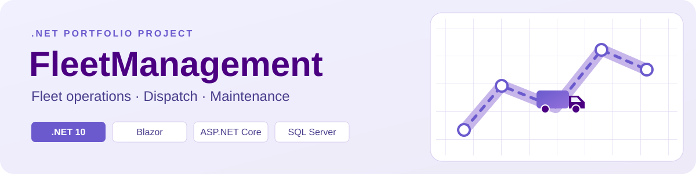
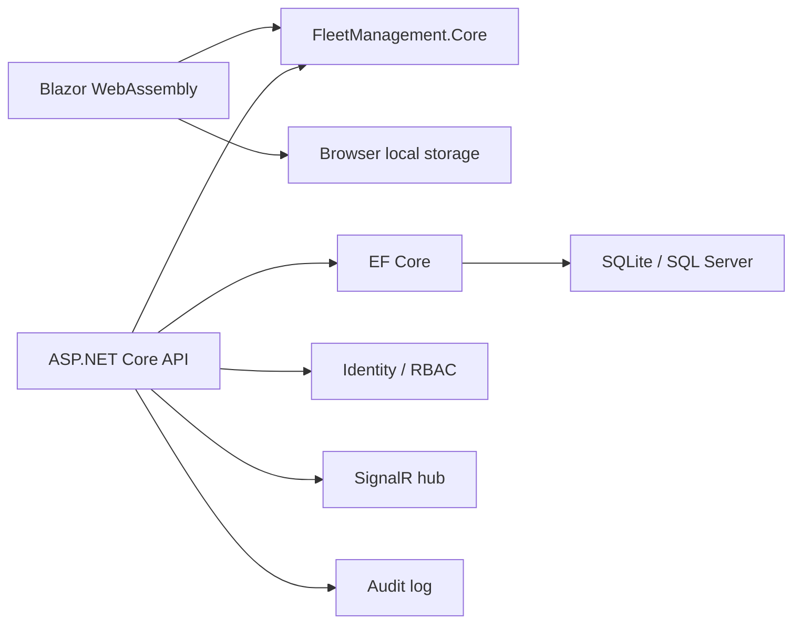

<div align="center">
  
  <h1>FleetManagement</h1>
  <p><strong>A modern .NET fleet operations platform, evolved from a WPF desktop application.</strong></p>
  <p>
    <a href="README.ru.md">Русская версия</a> ·
    <a href="docs/portfolio-v2.md">Demo guide</a> ·
    <a href="docs/backend.md">Backend documentation</a> ·
    <a href="docs/architecture.md">Architecture</a>
  </p>
  <p>
    <a href="https://github.com/ViolettaNcl/FleetManagement/actions/workflows/demo-ci.yml"></a>
    <a href="https://github.com/ViolettaNcl/FleetManagement/actions/workflows/api-ci.yml"></a>
    
    
    
  </p>
</div>

## Try the application

The browser edition runs C# in WebAssembly, uses synthetic data, and requires no backend, account, API key, or paid hosting. The GitHub Pages deployment is prepared but not yet verified live.

- [Latest browser builds and screenshots](https://github.com/ViolettaNcl/FleetManagement/actions/workflows/demo-ci.yml)
- [How to run the demo and enable GitHub Pages](docs/deployment.md)
- [Development pull request](https://github.com/ViolettaNcl/FleetManagement/pull/1)

### Guided demo (about two minutes)

| Screen | What to try |
| --- | --- |
| Vehicles / Drivers | Add a record, search by registration or name, edit it, and observe duplicate validation. |
| Calendar | Browse day, week and month, filter vehicles and open scheduled trips. |
| Dispatch | Suggest an available vehicle and driver; schedule a trip, then try a conflicting assignment. |
| Tracking | Play the simulated clock and inspect trip progress on the route schematic. |
| Maintenance | Compare service intervals and record a service to reset the maintenance assessment. |
| Optimization | Compare original, nearest-neighbor and 2-opt tours on seeded stops. |
| Intelligence | Train a local synthetic maintenance classifier and inspect held-out metrics and predictions. |
| Predictions | Train an ETA regressor, compare errors and scan synthetic telemetry anomalies. |
| Digital Twin | Initialize a seeded virtual fleet, inject incidents and inspect live synthetic ML scores. |
| Assistant | Review explainable service and dispatch alerts with an offline fixed-intent expert system. |
| Analytics | Filter trips by departure date and download a genuine two-sheet Excel workbook. |

Use **Reset demo** to restore the synthetic dataset. Changes stay in your browser.

## Engineering highlights

| Capability | Implementation |
| --- | --- |
| Browser UI | Blazor WebAssembly, responsive lavender WPF-inspired tables |
| Domain | Shared C# records, validation, conflict detection, explainable maintenance rules |
| Backend | ASP.NET Core minimal REST API, dependency injection, OpenAPI |
| Data | EF Core with SQLite and SQL Server; unique indexes and restrictive foreign keys |
| Security | Identity bearer login, Admin / Dispatcher / Viewer policies, rate-limited login and fleet audit |
| Realtime | Authenticated SignalR change notifications after successful writes |
| Reporting | Date-filtered analytics and native Open XML workbook generation |
| QA | Executable C# regression checks, HTTP integration matrix, Playwright browser scenarios |
| Deployment | GitHub Actions, static Pages workflow, optional local Docker Compose |

## Architecture



The static browser and local API are independent clients of the same C# rules. The original Windows WPF application remains in `FleetManagment/` as a legacy reference. [Design decisions and limitations](docs/architecture.md).

## Run locally

Requirements: .NET 10 SDK. Docker is optional.

```sh
dotnet run --project src/FleetManagement.Web
dotnet run --project tests/FleetManagement.Core.Checks -c Release
```

For the independent API, follow the [secure local configuration guide](docs/backend.md). Do not commit keys or passwords or expose the local API publicly. A Docker Compose example is available for SQL Server.

## Repository layout

```text
src/
  FleetManagement.Core/     Shared C# business rules and reports
  FleetManagement.Web/      Blazor browser edition
  FleetManagement.Api/      ASP.NET Core, EF Core, Identity, SignalR
tests/                      Modern regression, browser and HTTP checks
docs/                       Architecture, demo and deployment guides
FleetManagment/             Original WPF application and documentation
FleetManagement.Tests/      Original desktop tests (legacy)
.github/workflows/          CI and Pages
```

## Validation and project boundaries

The CI workflows are the source of truth for the latest test outcomes. Earlier revisions have passed both SQLite and SQL Server HTTP/Identity/audit/restart checks and browser smoke tests. The V2 baseline passed browser, API and CodeQL checks. V3 changes are under development and must pass their own CI before release. CI screenshots and published static builds are available as workflow artifacts.

The browser demo has synthetic data, local simulation rather than real GPS, and deterministic service interval rules plus a separate experimental classifier trained on synthetic telemetry. The local API is a portfolio implementation, not a hardened production service; schema migrations, multi-instance scheduling concurrency, account lifecycle, and durable events remain future work. The legacy WPF app has known security and test limitations.

[Security policy](SECURITY.md) · [Release checklist](docs/deployment.md) · [Change history](CHANGELOG.md)

## Original project documentation

The original Russian requirements, UML diagrams, SQL scripts and user/developer guides are preserved. See [README.ru.md](README.ru.md) for the complete index.
