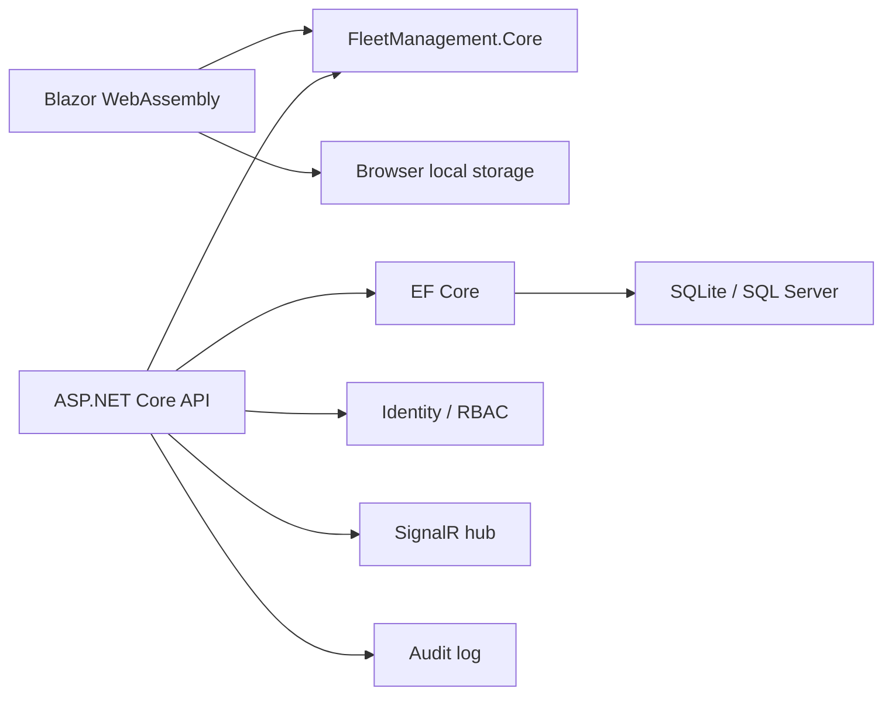

<div align="center">
  
  <h1>FleetManagement</h1>
  <p><strong>A modern .NET fleet operations platform, evolved from a WPF desktop application.</strong></p>
  <p>
    <a href="README.ru.md">Русская версия</a> ·
    <a href="docs/portfolio-v3.md">Demo guide</a> ·
    <a href="docs/backend.md">Backend documentation</a> ·
    <a href="docs/architecture.md">Architecture</a>
  </p>
  <p>
    <a href="https://github.com/ViolettaNcl/FleetManagement/actions/workflows/demo-ci.yml"></a>
    <a href="https://github.com/ViolettaNcl/FleetManagement/actions/workflows/api-ci.yml"></a>
    
    
    
  </p>
</div>

## Try the application

The browser edition runs C# in WebAssembly, uses synthetic data, and requires no backend, account, API key, or paid hosting. The GitHub Pages workflow supports the dedicated `preview/fleetops-v3` branch without merging master. [Expected demo URL](https://violettancl.github.io/FleetManagement/) is not certified live until deployment succeeds.

- [Latest browser builds, screenshots and actual screen-recorded portfolio tour](https://github.com/ViolettaNcl/FleetManagement/actions/workflows/demo-ci.yml)
- [How to run the demo and enable GitHub Pages](docs/deployment.md)
- [V3 development pull request](https://github.com/ViolettaNcl/FleetManagement/pull/2)

### Guided demo

The grouped V3 workspace includes an English/Russian navigation and overview switch (detailed offline modules remain English). It separates operational records, tracking/reporting, simulation/optimization and ML experiments. The overview combines live demo-clock trip counts, service readiness, today's agenda and rule-based alerts.

| Screen | What to try |
| --- | --- |
| Vehicles / Drivers | Add a record, search by registration or name, edit it, and observe duplicate validation. |
| Vehicle Passport | Open a registered vehicle's trip history, latest service, recorded maintenance work and upcoming assignments. |
| Resource Planning | Register driver shifts, inspect daily assignments and optionally enforce shift coverage during dispatch. |
| Calendar | Browse day, week and month, filter vehicles and open scheduled trips. |
| Dispatch | Suggest an available vehicle and driver; schedule a trip, then try a conflicting assignment. |
| Tracking | Play the simulated clock and inspect trip progress on the route schematic. |
| Maintenance | Compare service intervals, record scheduled service, repair or inspection, and review persistent work history. |
| Optimization | Compare original, nearest-neighbor and 2-opt tours on seeded stops. |
| Intelligence | Train a local synthetic maintenance classifier and inspect held-out metrics and predictions. |
| Predictions | Train an ETA regressor, compare errors and scan synthetic telemetry anomalies. |
| Digital Twin | Initialize a seeded virtual fleet, inject incidents and inspect live synthetic ML scores. |
| Assistant | Review explainable service and dispatch alerts with an offline fixed-intent expert system. |
| Multi Dispatch | Compare capacity/time-window heuristics, inspect Gantt timelines and unassigned orders. |
| What-if | Compare complete seeded Digital Twin scenarios, completion and fuel intensity. |
| Geo Map | Replay synthetic regional journeys on bundled Natural Earth geometry with geofence history. |
| Model Registry | Import local experiment manifests, compare reported ML metrics and inspect fingerprints. |
| Data Quality | Inspect bounded numeric telemetry CSV, row errors, duplicates and label distribution. |
| Cost Intelligence | Estimate completed-trip costs and occupancy, project a period budget and export a four-sheet financial Excel workbook. |
| Demand Forecast | Compare seasonal baseline and weekday-trend regression on a chronological synthetic holdout. |
| Analytics | Filter trips by departure date and download a genuine two-sheet Excel workbook. |

Use **Reset demo** to restore the synthetic dataset. Changes stay in your browser.

## Release candidate preview

The Browser demo CI artifact `fleetmanagement-portfolio-tour` records the real synthetic offline application (WebM, optional MP4), including ML and optimization labs. See [portfolio walkthrough](docs/portfolio-v3.md). The connected API is not deployed publicly. Release acceptance requires successful exact-commit checks and manual review; no release tag or Pages deployment is implied.

## Local ML.NET training

Run `dotnet run --project tools/FleetManagement.ModelTrainer -c Release -- model-registry 42` to train FastTree binary and regression models, compare with the existing C# baselines on identical held-out data, and create a local versioned experiment registry. See [ML trainer and model registry](docs/model-registry.md). The browser remains independent of ML.NET native training and does not load these archives automatically.

## Engineering highlights

| Capability | Implementation |
| --- | --- |
| Browser UI | Blazor WebAssembly, responsive lavender WPF-inspired tables |
| Domain | Shared C# records, validation, conflict detection, explainable maintenance rules |
| Backend | ASP.NET Core minimal REST API, dependency injection, OpenAPI |
| Data | EF Core with SQLite and SQL Server; unique indexes and restrictive foreign keys |
| Security | Identity bearer login, Admin / Dispatcher / Viewer policies, rate-limited login and fleet audit |
| Realtime | Authenticated SignalR change notifications after successful writes |
| Reporting | Date-filtered analytics and native Open XML workbook generation |
| QA | Executable C# regression checks, HTTP integration matrix, Playwright browser scenarios |
| Deployment | GitHub Actions, static Pages workflow, optional local Docker Compose |

## Architecture



The static browser and local API are independent clients of the same C# rules. The original Windows WPF application remains in `FleetManagment/` as a legacy reference. [Design decisions and limitations](docs/architecture.md).

## Run locally

Requirements: .NET 10 SDK. Docker is optional.

```sh
dotnet run --project src/FleetManagement.Web
dotnet run --project tests/FleetManagement.Core.Checks -c Release
```

For the independent API, follow the [secure local configuration guide](docs/backend.md). Do not commit keys or passwords or expose the local API publicly. A Docker Compose example is available for SQL Server.

## Repository layout

```text
src/
  FleetManagement.Core/     Shared C# business rules and reports
  FleetManagement.Web/      Blazor browser edition
  FleetManagement.Api/      ASP.NET Core, EF Core, Identity, SignalR
tests/                      Modern regression, browser and HTTP checks
docs/                       Architecture, demo and deployment guides
FleetManagment/             Original WPF application and documentation
FleetManagement.Tests/      Original desktop tests (legacy)
.github/workflows/          CI and Pages
```

## Validation and project boundaries

The CI workflows are the source of truth for the latest test outcomes. Earlier revisions have passed both SQLite and SQL Server HTTP/Identity/audit/restart checks and browser smoke tests. The V2 baseline passed browser, API and CodeQL checks. V3 changes are under development and must pass their own CI before release. CI screenshots and published static builds are available as workflow artifacts.

The browser demo has synthetic data, local simulation rather than real GPS, and deterministic service interval rules plus a separate experimental classifier trained on synthetic telemetry. The local API is a portfolio implementation, not a hardened production service; schema migrations, multi-instance scheduling concurrency, account lifecycle, and durable events remain future work. The legacy WPF app has known security and test limitations.

[Security policy](SECURITY.md) · [Release checklist](docs/deployment.md) · [Change history](CHANGELOG.md)

## Original project documentation

The original Russian requirements, UML diagrams, SQL scripts and user/developer guides are preserved. See [README.ru.md](README.ru.md) for the complete index.

### Integrated batch dispatch

Create trip requests in Batch Dispatch, compare two assignment heuristics, review the proposed subset, then explicitly apply. Assigned trips enter the shared register/calendar; pending requests stay in the session. See [batch dispatch](docs/batch-dispatch.md).

### Local connected workspace (V3)

With the local API running, open http://127.0.0.1:5095/console and sign in using your existing Identity account. Use server-backed dashboard, calendar, trip/batch dispatch, financial Excel, register editing, maintenance and resource forms; administrators can list/create staff accounts. The connected shell supports EN/RU; some server messages and exports remain English. Offline GitHub Pages demo remains independent. See [backend operations](docs/backend-operations.md), [database recovery](docs/database-recovery.md) and [database concurrency](docs/database-concurrency.md).

### Performance checks

The backend provider matrix includes a bounded read-only concurrency smoke and aggregate timing artifacts. See [performance testing](docs/performance-testing.md). Measurements are for the small disposable test dataset, not production fleet capacity.

For a guided walkthrough, see [V3 portfolio guide](docs/portfolio-v3.md). On Windows with PowerShell 7 and .NET 10 SDK, `pwsh -File tools/start-connected.ps1` prepares a private local SQLite database and starts the connected workspace. No public deployment or secret is required for this local demo.

### Model monitoring and candidate review

The offline Model Drift lab compares synthetic feature distributions using PSI, then supports a validation-ranked retraining candidate review with independent final evaluation. See [model drift](docs/model-drift.md). The experiments do not imply real-world model performance or automated deployment.

For release review, the manual [Release evidence gate](https://github.com/ViolettaNcl/FleetManagement/actions/workflows/release-gate.yml) checks exact-commit CI and the separate GitHub Advanced Security CodeQL results check and produces JSON without tagging, merging or deployment. See [deployment checklist](docs/deployment.md) and [logical ER diagram](docs/architecture.md#logical-persistence-model-v3).

V3 release hardening: localized offline analytics/finance workbooks and assistant alerts, read-only receipt capacity monitoring (Admin), provider catalog parity preflight and technical video validation. API defaults remain English. Review the exact-commit evidence; remaining dynamic laboratory text and existing database history adoption are not certified.
