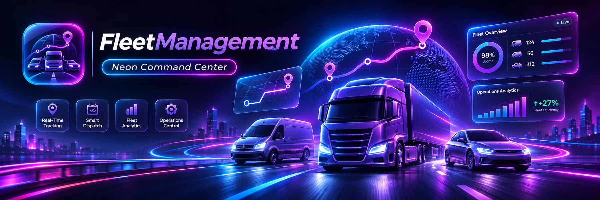
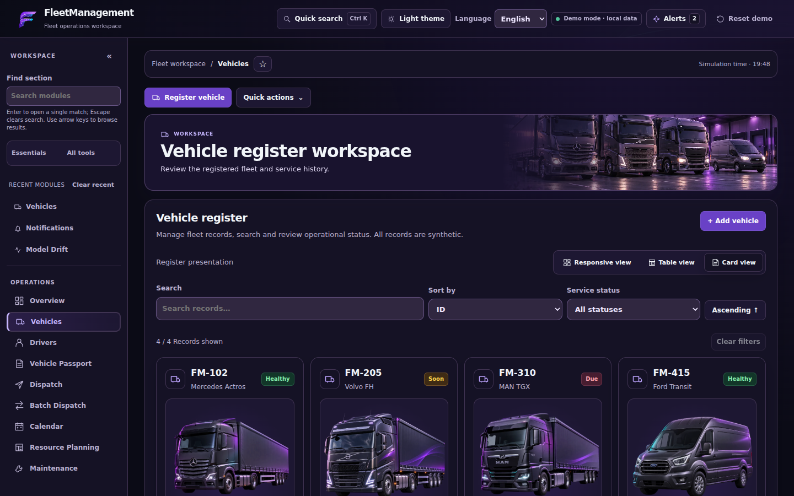
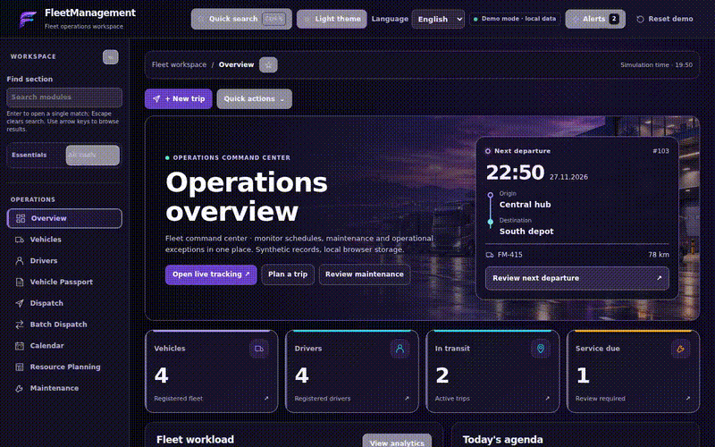

<h1>FleetManagement</h1>

<strong>Управление автопарком · Оптимизация · Прикладное машинное обучение</strong>

<code>C# / .NET 10</code> · <code>Blazor WASM</code> · <code>ASP.NET Core</code> · <code>EF Core</code> · <code>ML.NET</code>

<a href="README.md">English</a> · <a href="https://violettancl.github.io/FleetManagement/app/">Онлайн-приложение</a> · <a href="docs/engineering/README.ru.md">Техническое руководство</a>

Концептуальная иллюстрация; показатели не являются реальной телеметрией или измеренной производительностью.

  

    
    
    
    
    
    
  

**Русский** · [English](README.md)

[Онлайн-приложение](https://violettancl.github.io/FleetManagement/app/) · [Техническое руководство](docs/engineering/README.ru.md) · [Галерея](docs/visuals/gallery.ru.md) · [История изменений](CHANGELOG.md)

Статусы CI относятся к ветке разработки. Подтверждённая публичная версия указана отдельно ниже.

**На этой странице**

- [Релиз и подтверждение качества](#релиз-и-подтверждение-качества)
- [Визуальный обзор приложения](#визуальный-обзор-приложения)
- [Возможности](#возможности)
- [Архитектура](#архитектура)
- [Инженерная реализация](#инженерная-реализация)
- [Демонстрация рабочих сценариев](#демонстрация-рабочих-сценариев)
- [Быстрый запуск](#быстрый-запуск)
- [Структура репозитория](#структура-репозитория)
- [Техническая документация](#техническая-документация)
- [Ограничения и сопровождение](#ограничения-и-сопровождение)

## Релиз и подтверждение качества

**V6.3 Enterprise — публичная портфолио-версия.** Последнее подтверждённое развёртывание: [`f2cea2b`](https://github.com/ViolettaNcl/FleetManagement/commit/f2cea2bfe5334fed0e056feb142e56db8fc470c0). 27 ноября 2026 года успешно завершились восемь CI-процессов и четыре этапа Pages, включая проверку реального публичного адреса. Коммиты документации не заменяют опубликованную ревизию автоматически.

| Точка входа | Назначение |
| --- | --- |
| [Интерактивное приложение](https://violettancl.github.io/FleetManagement/app/) | Автономное демо на синтетических данных, без регистрации |
| [Публичный сайт](https://violettancl.github.io/FleetManagement/) / [Русская версия](https://violettancl.github.io/FleetManagement/ru/) | Обзор продукта |
| [Подтверждённая публикация](https://github.com/ViolettaNcl/FleetManagement/actions/runs/46058985410) | Сборка, доказательства безопасности, развёртывание и проверка сайта |
| [Ветка разработки](https://github.com/ViolettaNcl/FleetManagement/tree/feature/approved-fleet-assets) | Исходный код кандидата; CI относится к конкретному коммиту |
| [Browser CI](https://github.com/ViolettaNcl/FleetManagement/actions/workflows/demo-ci.yml) | Скриншоты, запись реального интерфейса и сборки |

## Визуальный обзор приложения

*Рис. 1. Рабочее пространство Overview, реальный кадр из CI.*

Реестр транспорта — открыть второй скриншот

*Рис. 2. Карточки транспорта с изображениями моделей.*

Реальные кадры CI; нажмите для просмотра оригинала. Синтетические данные.

Анимированный фрагмент реальной записи

[Полная видеозапись](docs/visuals/media/application-tour.mp4)

**[Полная визуальная документация](docs/visuals/README.ru.md)** · [Галерея](docs/visuals/gallery.ru.md) · [Диаграммы](docs/visuals/diagrams.ru.md) · [Результаты ML](docs/visuals/analytics.ru.md)

## Возможности

FleetManagement вырос из настольного WPF-приложения в модульный инженерный портфолио-проект на .NET. Это не готовая промышленная SaaS-платформа и не система диагностики техники.

| Направление | Реализованное поведение |
| --- | --- |
| Операции | Реестры транспорта и водителей, рейсы, диспетчеризация, журнал ТО, смены, резервирование и календарь |
| Оптимизация | Маршрутные и многомашинные сценарии, предварительный расчёт и подтверждение пакетных назначений |
| Аналитика | Сравнение периодов, оценка затрат, бюджетные сценарии, XLSX и печатные отчёты |
| Интеллектуальные функции | Детерминированный помощник, синтетические модели ТО/ETA/аномалий, кластеризация, прогноз спроса, дрейф и локальный реестр моделей |
| Интерфейс | 26 разделов, «Основное» / «Все инструменты», RU/EN, две темы, адаптивные реестры и 36 оптимизированных иллюстраций |
| Подключённый режим | Отдельный локальный API и авторизованная консоль, SQLite/SQL Server, аудит и уведомления после сохранения |

## Архитектура

~~~mermaid
flowchart TB
  P[Публичный сайт] --> W[Blazor WASM]
  W --> C[Общее ядро C#]
  W --> L[(Хранилище браузера)]
  U[Подключённая консоль] --> A[ASP.NET Core API]
  A --> C
  A --> D[(SQLite / SQL Server)]
  A --> H[SignalR]
  M[Локальный ML.NET Trainer] --> C
  M --> R[(Реестр моделей)]
~~~

Два рабочих пространства не синхронизируют данные. Pages размещает только статические файлы; API, база и секреты не публикуются. ML.NET Trainer — отдельная CLI-утилита, не сервис инференса.

## Инженерная реализация

| Инженерная задача | Реализованный подход |
| --- | --- |
| Двойное назначение | Полуоткрытые интервалы, серверная перепроверка и блокировка записи провайдера |
| Потеря HTTP-ответа | Устойчивые UUID-квитанции по субъекту; повтор исходного успешного ответа |
| Целостность расписания | Общие правила C#, внешние ключи, явное подтверждение и опциональное покрытие сменами |
| Поиск маршрута | Nearest neighbor, ограниченный 2-opt, deterministic multi-start, точный Held–Karp для малых задач |
| Оценка моделей | Разделение по группам или времени, preprocessing только на train, сравнение с baseline |
| Целостность релиза | CI точного SHA/ветки, SARIF CodeQL, проверка опубликованной ревизии и хешей |

[Доменная спецификация](docs/engineering/domain.ru.md) · [Справочник алгоритмов](docs/engineering/algorithms.ru.md) · [Инженерное руководство](docs/engineering/README.ru.md)

## Демонстрация рабочих сценариев

Откройте [проверенное приложение](https://violettancl.github.io/FleetManagement/app/) и переключитесь на «Все инструменты» для расширенных модулей. Начните с обзора, откройте транспорт и карточки моделей, запланируйте рейс, сравните стратегии оптимизации, запустите ML-эксперимент и экспортируйте отчёт. [Browser CI](https://github.com/ViolettaNcl/FleetManagement/actions/workflows/demo-ci.yml) предоставляет реальные записи экрана и скриншоты в артефактах, а не сгенерированные скриншоты продукта. Прежний баннер README — концептуальная иллюстрация.

## Быстрый запуск

Требования: Git, .NET 10 SDK; PowerShell 7 для запуска подключённой консоли. Node.js и Python нужны для соответствующих инженерных проверок, но не для обычной работы публичного демо.

~~~powershell
git clone --branch feature/approved-fleet-assets https://github.com/ViolettaNcl/FleetManagement.git
cd FleetManagement
dotnet run --project src/FleetManagement.Web
~~~

Откройте локальный адрес из вывода .NET. Для подключённого режима из корня проекта в PowerShell 7:

~~~powershell
pwsh -File tools/start-connected.ps1
~~~

Откройте http://127.0.0.1:5095/console. При создании новой SQLite-базы скрипт безопасно запрашивает пароль администратора. Используйте синтетические данные. Подробнее: [локальная эксплуатация и восстановление](docs/engineering/operations.ru.md).

## Структура репозитория

| Каталог | Ответственность |
| --- | --- |
| src/FleetManagement.Core | Доменные записи, правила, аналитика, ML-эксперименты и экспорт |
| src/FleetManagement.Web | Автономный Blazor UI и статические ресурсы |
| src/FleetManagement.Api | Локальный Minimal API, EF Core, Identity, встроенная консоль |
| tools/ | Лаунчер, обучение моделей, восстановление, упаковка и проверка релизов |
| tests/ | Доменные, HTTP, realtime, браузерные, ML и recovery-проверки |
| site/ | Двуязычные публичные страницы и стили |
| FleetManagment/ | Исторический проект WPF / EF6 / .NET Framework 4.7.2 |
| docs/ | Технические спецификации и история архитектурных решений |

## Техническая документация

- **Инженерный индекс** — [Открыть](docs/engineering/README.ru.md) · [Open](docs/engineering/README.md)
- **Архитектура и целостность данных** — [Открыть](docs/engineering/architecture.ru.md) · [Open](docs/engineering/architecture.md)
- **Доменная спецификация** — [Открыть](docs/engineering/domain.ru.md) · [Open](docs/engineering/domain.md)
- **Алгоритмы и математические контракты** — [Открыть](docs/engineering/algorithms.ru.md) · [Open](docs/engineering/algorithms.md)
- **Контракт API** — [Открыть](docs/engineering/api.ru.md) · [Open](docs/engineering/api.md)
- **ML и оценка моделей** — [Открыть](docs/engineering/intelligence.ru.md) · [Open](docs/engineering/intelligence.md)
- **Frontend и дизайн** — [Открыть](docs/engineering/frontend.ru.md) · [Open](docs/engineering/frontend.md)
- **Эксплуатация и релиз** — [Открыть](docs/engineering/operations.ru.md) · [Open](docs/engineering/operations.md)
- **Качество и безопасность** — [Открыть](docs/engineering/quality.ru.md) · [Open](docs/engineering/quality.md)

## Ограничения и сопровождение

- Записи, метрики, телеметрия и ML-эксперименты демонстрационные; не вводите реальные персональные или коммерческие данные.
- Подключённый API предназначен для локальной разработки, не для публичного промышленного использования.
- Модели экспериментальные и не подтверждают техническую безопасность, не назначают рейсы автоматически и не гарантируют реальные прогнозы.
- О проблемах безопасности сообщайте приватно: [политика безопасности на русском](SECURITY.ru.md).
- Историческая документация сохранена в [FleetManagment/Документы](FleetManagment/Документы); ранние README доступны в истории Git.

См. [историю изменений](CHANGELOG.md) и [происхождение изображений](docs/fleet-approved-assets.md). Оригиналы PNG сохранены отдельно в архиве владельца.
