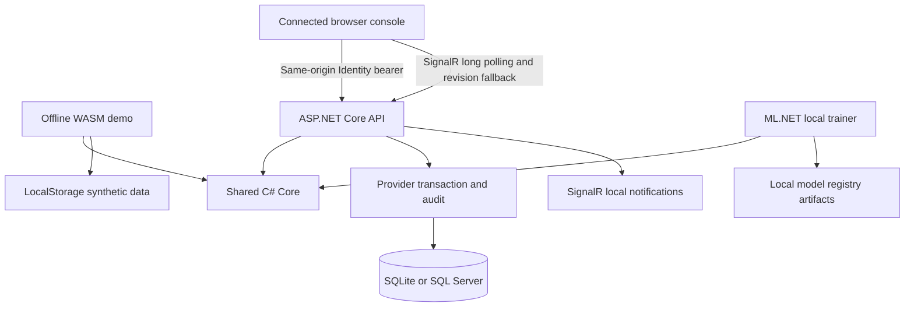
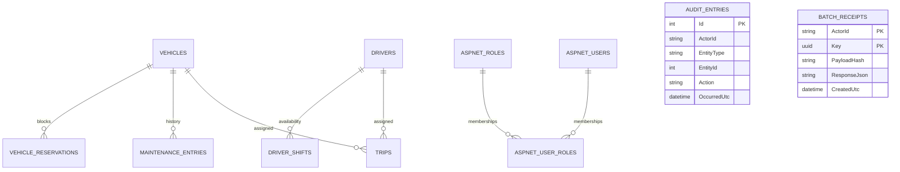

# Architecture and design decisions

## Context

FleetManagement began as a Windows WPF application on .NET Framework 4.7.2 and EF6. Rather than replacing its source and identity, the modern edition introduces independently runnable .NET 10 browser and API projects. The WPF project is preserved as historical code; it does not yet share the modern core.

| Component | Responsibility |
| --- | --- |
| Core | Records, validation, scheduling, service intervals, analytics and workbook generation; no UI or database dependency |
| Web | Razor components, responsive WPF-inspired design, synthetic data and local browser storage |
| API | HTTP DTOs, authorization, business operations, EF persistence, audit and SignalR notifications |
| Database | SQLite for low-friction local setup; SQL Server for relational integration and Docker |
| Test projects | Executable rule checks, HTTP integration, SignalR client and browser scenarios |

## Decisions

### ADR-001 — Static demo and local API remain independent

GitHub Pages hosts the WASM files, not a server or a database. The browser never receives an API key or a production connection string. This reduces deployment friction and lets recruiters explore the product without registering. V3 now serves a separate same-origin connected workspace at /console from the API. It uses Identity bearer login and memory-only tokens. No automatic synchronization with the static WASM demo; external deployment requires HTTPS and hardening.

### ADR-002 — A shared core instead of duplicated business rules

The scheduling and report functions run in both the browser and API. UI feedback is not a security boundary: server-side write endpoints validate their own requests. A vehicle or driver cannot be deleted while related trip history exists.

### ADR-003 — Scheduling and data integrity

An in-process semaphore plus a provider-level transaction lock serializes cooperating V3 fleet mutations across API processes. SQLite reserves its writer; SQL Server uses a transaction-owned application lock. Foreign keys and unique indexes protect references. Direct database writers and earlier versions bypass this protocol; stable non-reused IDs and durable idempotency remain open.

### ADR-004 — Identity and audit

Identity stores salted password hashes and provides short-lived opaque bearer tokens. Role policies distinguish read and write access; the automation key is separate from admin privileges. Fleet audit records are persisted with the same database SaveChanges operation. It is an application audit, not a tamper-proof compliance ledger.

### ADR-005 — Simulated tracking and explainable maintenance

Tracking interpolates positions on a schematic route using simulated time. No GPS devices or route provider are connected. Maintenance compares remaining mileage and days with thresholds. It is deterministic decision support, not machine learning.

### ADR-006 — Native spreadsheet export

The operational and financial reports use standard Office Open XML with two and four sheets respectively; user strings are stored as inline text, not formulas. The workbook contains numeric cells for calculations and can be generated without proprietary packages.

## Verification strategy

- Core regression executable: business invariants and report calculations.
- API integration: real HTTP, SQLite and SQL Server, authorization and persistence across restarts.
- Realtime: authenticated SignalR negotiation and change notifications after committed writes.
- Browser: published WASM at the GitHub Pages-style subpath, state persistence, key journeys, mobile layout and Excel downloads.
- GitHub Actions artifacts: screenshots and static output are generated from code rather than mockups.

## Remaining technical debt

V2-to-V3 additive schema upgrade and SQLite recovery are implemented; full versioned EF migration history and legacy WPF import remain open. Staff role changes and HTTP session revocation, durable batch receipts and a narrow SignalR Long Polling subscriber are implemented. Full account lifecycle, distributed SignalR, idempotency for other operations, production observability and complete UI parity remain open. Legacy WPF security and legacy tests remain unresolved. See SECURITY.md and the backend guide.

## V3 component boundaries

Neither UI automatically imports or synchronizes the other store. The ML trainer uses synthetic datasets and does not deploy models into the API. See [security review](security-review-v3.md), [database concurrency](database-concurrency.md), [recovery](database-recovery.md) and [performance](performance-testing.md).

## Logical persistence model (V3)

Audit actor/entity references and receipt actor IDs are logical references, not foreign keys: historical records survive deletion of operational entities. BatchReceipts also stores versioned ordinary fleet write receipts; see [receipt contract](batch-receipts.md). Current databases use explicit, verified additive upgrade from the known V2/V3 schemas, not a complete EF migration history. A future migration baseline requires provider-specific model snapshots, explicit operator adoption and tested preservation of all existing records; never run an initial create migration over an existing database.

## ADR — V4 public discovery and scoped offline demo

The Pages release packages static product pages at the project root and Russian equivalents under `/ru/`. The public copy is built from `site/pages.json`; `tools/build_public_site.py` generates canonical URLs, language alternatives, sitemap, metadata, structured data and semantic mapping. Only the public pages are indexable. The WASM demo moves to `/app/` in this packaging step, has a noindex directive and uses a service worker scoped to that directory. The connected ASP.NET Core workspace is not part of this package, and its tokens and server data are not cached by the PWA. Existing local and portable Windows entry points retain their original location. Shared business rules and storage boundaries are unchanged.
