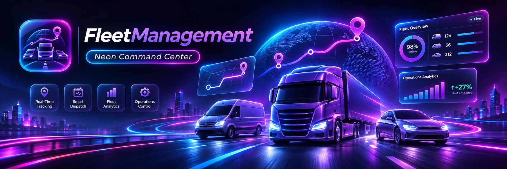

# FleetManagement — Neon Violet identity

> Current V6.3 reference: [Engineering handbook](engineering/README.md) · [Русский](engineering/README.ru.md). This specialist document retains historical context; use current code and exact-release evidence for deployment claims.

Three generated visual compositions requested for FleetManagement V6.1. Optimized WebP versions are stored directly in Git; original PNG files remain in the supplied brand asset archive. The existing compact SVG app icon and PWA icons remain unchanged for readability at small sizes.

The banner is conceptual artwork, **not an application screenshot**. Any depicted uptime, efficiency, vehicle counts and live labels are illustrative, not verified product measurements or real GPS telemetry.

| Transparent logo | Dark-background logo |
| --- | --- |
|  |  |

## Usage

- Banner: English and Russian README introductions.
- Transparent logo: documentation, presentations and flexible brand lockups.
- Dark logo: About/settings artwork in the browser workspace; also suitable for dark portfolio backgrounds.
- Keep the existing SVG for small favicon and PWA use. Do not enlarge decorative imagery in operational forms or registers.
- These are static 3D-style renders, not editable 3D geometry or animated assets.

## Integrity

| Asset | Dimensions | Bytes | SHA-256 |
| --- | ---: | ---: | --- |
| `fleet-readme-banner.webp` | 1800 × 600 | 181294 | `3d6d24f85e45a597976de5db6cf4bb084b249710246933edb514ed82693a2133` |
| `fleet-logo-transparent.webp` | 1000 × 1000 | 83416 | `ef02eda93f29b25692d7c8653a90b97f2c6fc127c4467516b2e607069f06d233` |
| `fleet-logo-dark.webp` | 1000 × 1000 | 55294 | `806ea5f910ab82581725ed000be282921eddf0c762a7048a9ae684ed8cdc46fd` |

The generated brand artwork does not change application capabilities, release status or the scope of synthetic data.
