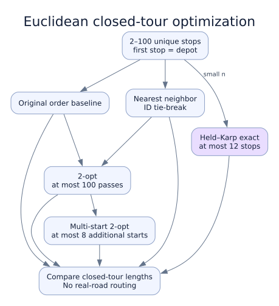

# Algorithm reference: routing, forecasting and drift

**English** · [Русский](algorithms.ru.md)

[Project README](../../README.md) · [Handbook index](README.md) · [Visual evidence](../visuals/README.md)

Source-grounded V6.3 mathematical contracts; complexity below is analytical, not a measured benchmark.

**On this page**

- [1. Route optimization](#1-route-optimization)
- [2. Demand forecast](#2-demand-forecast)
- [3. Population Stability Index](#3-population-stability-index)
- [4. Numerical and validation discipline](#4-numerical-and-validation-discipline)
- [Visual evidence](#visual-evidence)

## 1. Route optimization

RouteOptimizer.Compare accepts 2–100 unique stop IDs, finite coordinates bounded to ±10,000. First stop is the depot. It returns closed tours with the depot repeated at the end. Distance is Euclidean:

~~~text
d(a,b) = sqrt((ax-bx)^2 + (ay-by)^2)
L(tour) = sum d(tour[i-1], tour[i])
~~~

The original order is the baseline. Nearest neighbor picks minimum distance, ties by stop ID. The actual implementation sorts remaining candidates each iteration: upper bound O(n² log n), not the O(n²) of a linear-scan implementation.

2-opt starts with the better of baseline and greedy tour. Swap an internal segment only when the replacement edge pair is shorter by more than 1e-9; at most 100 passes. A pass compares O(n²) edge pairs; each accepted Array.Reverse can cost O(n). Conservative worst-case O(100 n³), not a constant-time reversal assumption. Multi-start tries up to eight additional first stops, ordered by descending depot distance then ID. Keep best strictly improving tour.

Held–Karp is included only for at most 12 stops including depot. With m = n−1 non-depot stops:

~~~text
D[{j},j] = d(depot,j)
D[S,j] = min over k in S without j: D[S without j,k] + d(k,j)
answer = min_j (D[all,j] + d(j,depot))
~~~

Time O(m² 2^m), memory O(m 2^m) including predecessor reconstruction. It is exact for this Euclidean closed-tour objective, not real-road VRP. No travel-time windows, traffic or geographic distances are optimized by this algorithm.

## 2. Demand forecast

Synthetic 112-day series: rounded nonnegative orders generated using linear trend 0.18/day, weekday offsets and seeded integer noise. Train first 84 days, evaluate on final 28. Seasonal-naive repeats the last training week; alternative fits common slope and distinct weekday intercepts using within-weekday centered least squares.

~~~text
slope = sum((day - weekdayMeanDay) * (orders - weekdayMeanOrders))
        / sum((day - weekdayMeanDay)^2)
forecast(day) = max(0, weekdayMeanOrders + slope*(day-weekdayMeanDay))
MAE = mean(abs(actual - prediction))
~~~

A zero denominator yields slope zero. Both models predict untouched holdout first; after reporting MAE they refit all 112 days for future horizon 1–28. Future Actual is null, not a fabricated label. No market calibration or prediction interval.

## 3. Population Stability Index

Reference/current windows each 20–20,000 rows, five finite features bounded to absolute 1e9. Derive up to nine distinct decile cutpoints from sorted reference; use identical open-ended bins for current, smoothing 0.5 per bin.

~~~text
p_i = (referenceCount_i + 0.5)/(referenceN + 0.5 * bins)
q_i = (currentCount_i + 0.5)/(currentN + 0.5 * bins)
PSI = sum((q_i-p_i) * ln(q_i/p_i))
~~~

High ≥ 0.25, Watch ≥ 0.10, Low otherwise. Identical windows give zero. Duplicate cutpoints collapse; smoothing avoids log(0). Also report mean predictions of the same logistic model. These fixed thresholds are demonstration heuristics, not universal alarms. Drift does not establish a performance loss without labels; no automatic retraining/promotion.

## 4. Numerical and validation discipline

| Concern | Contract / engineering implication |
| --- | --- |
| Route stability | deterministic ID tie-break, unique stops and closed tour |
| Search bounds | bounded 2-opt passes and starts; exact solution restricted to small n |
| Leakage | chronological demand holdout; group-disjoint maintenance cohorts |
| Probability | Brier = mean squared probability error; use validation for threshold selection |
| Ranking | ROC-AUC/AP tied-score handling; single-class unavailable |
| Missing labels | no simulated future actuals; PSI is unsupervised |
| Benchmarks | record exact seed, dataset size, hardware/runtime and repeated measurements; do not claim speedup from complexity alone |

See [RouteOptimizer.cs](../../src/FleetManagement.Core/RouteOptimizer.cs), [DemandForecast.cs](../../src/FleetManagement.Core/DemandForecast.cs), [ModelDrift.cs](../../src/FleetManagement.Core/ModelDrift.cs), [RankingEvaluation.cs](../../src/FleetManagement.Core/RankingEvaluation.cs), [ML guide](intelligence.md).

## Visual evidence

[All diagrams](../visuals/diagrams.md) · [Gallery](../visuals/gallery.md)

---

[Project README](../../README.md) · [Handbook index](README.md) · [Русский](algorithms.ru.md)
