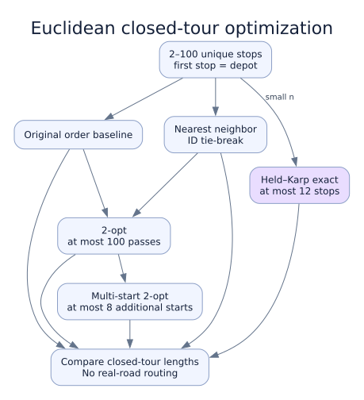

# Справочник алгоритмов: маршруты, прогноз и дрейф

**Русский** · [English](algorithms.md)

[README проекта](../../README.ru.md) · [Оглавление руководства](README.ru.md) · [Визуальные материалы](../visuals/README.ru.md)

Математические контракты V6.3 по исходному коду; сложность аналитическая, не измеренный benchmark.

**На этой странице**

- [1. Оптимизация маршрута](#1-оптимизация-маршрута)
- [2. Прогноз спроса](#2-прогноз-спроса)
- [3. Population Stability Index](#3-population-stability-index)
- [4. Численная устойчивость и дисциплина оценки](#4-численная-устойчивость-и-дисциплина-оценки)
- [Визуальные материалы](#визуальные-материалы)

## 1. Оптимизация маршрута

RouteOptimizer.Compare принимает 2–100 уникальных ID остановок, конечные координаты в пределах ±10 000. Первая остановка — депо. Результат — замкнутые маршруты с повтором депо в конце. Расстояние евклидово:

~~~text
d(a,b) = sqrt((ax-bx)^2 + (ay-by)^2)
L(tour) = sum d(tour[i-1], tour[i])
~~~

Исходный порядок — baseline. Nearest neighbor выбирает минимальное расстояние, при равенстве — ID. Реализация сортирует остаток на каждой итерации: верхняя граница O(n² log n), не O(n²) линейного поиска.

2-opt начинает с лучшего из исходного и жадного маршрута. Разворот внутреннего сегмента принимается только при выигрыше пары рёбер более 1e-9; максимум 100 проходов. Проход сравнивает O(n²) пар, принятый Array.Reverse может стоить O(n). Консервативная верхняя граница O(100 n³), а не предположение о константном развороте. Multi-start проверяет до восьми дополнительных первых остановок по убыванию расстояния от депо, затем ID. Сохраняет строго улучшенный маршрут.

Held–Karp включается только до 12 остановок с депо. При m = n−1 остановках вне депо:

~~~text
D[{j},j] = d(depot,j)
D[S,j] = min over k in S without j: D[S without j,k] + d(k,j)
answer = min_j (D[all,j] + d(j,depot))
~~~

Время O(m² 2^m), память O(m 2^m) с восстановлением по predecessor. Точность относится к евклидову замкнутому туру, не дорожной VRP. Временные окна, трафик и географические расстояния этим алгоритмом не оптимизируются.

## 2. Прогноз спроса

Синтетические 112 дней: округлённые неотрицательные заказы с трендом 0,18/день, эффектом дня недели и целочисленным шумом по seed. Обучение — первые 84, оценка — последние 28. Seasonal-naive повторяет последнюю неделю train; альтернативная модель обучает общий наклон и отдельные intercept дня недели по центрированным МНК.

~~~text
slope = sum((day - weekdayMeanDay) * (orders - weekdayMeanOrders))
        / sum((day - weekdayMeanDay)^2)
forecast(day) = max(0, weekdayMeanOrders + slope*(day-weekdayMeanDay))
MAE = mean(abs(actual - prediction))
~~~

При нулевом знаменателе наклон ноль. Сначала прогноз нетронутого holdout и MAE; затем переобучение по всем 112 дням для будущего горизонта 1–28. Future Actual = null, не выдуманная метка. Нет калибровки рынка или интервала прогноза.

## 3. Population Stability Index

Reference/current по 20–20 000 строк, пять конечных признаков с модулем ≤ 1e9. До девяти разных децильных границ по отсортированной reference; одинаковые открытые крайние интервалы для current, сглаживание 0,5 на корзину.

~~~text
p_i = (referenceCount_i + 0.5)/(referenceN + 0.5 * bins)
q_i = (currentCount_i + 0.5)/(currentN + 0.5 * bins)
PSI = sum((q_i-p_i) * ln(q_i/p_i))
~~~

High ≥ 0,25, Watch ≥ 0,10, иначе Low. Одинаковые окна дают ноль. Повторные границы объединяются; сглаживание исключает log(0). Дополнительно сравниваются средние прогнозы одной логистической модели. Пороги — демонстрационные эвристики, не универсальная сигнализация. Без меток дрейф не доказывает потерю качества; нет автоматического переобучения/продвижения.

## 4. Численная устойчивость и дисциплина оценки

| Вопрос | Контракт / инженерное следствие |
| --- | --- |
| Устойчивость маршрута | детерминированный ID tie-break, уникальные остановки, замкнутый тур |
| Границы поиска | ограничение проходов и стартов 2-opt; точный метод только для малого n |
| Leakage | хронологический holdout спроса; разные машины в группах ТО |
| Вероятности | Brier — средняя квадратичная ошибка вероятности; порог выбирается на validation |
| Ранжирование | обработка совпавших score ROC-AUC/AP; один класс — недоступно |
| Нет меток | не выдумывать future actual; PSI без учителя |
| Benchmark | записывать seed, размер, hardware/runtime и повторные измерения; не заявлять ускорение из сложности |

См. [RouteOptimizer.cs](../../src/FleetManagement.Core/RouteOptimizer.cs), [DemandForecast.cs](../../src/FleetManagement.Core/DemandForecast.cs), [ModelDrift.cs](../../src/FleetManagement.Core/ModelDrift.cs), [RankingEvaluation.cs](../../src/FleetManagement.Core/RankingEvaluation.cs), [ML-руководство](intelligence.ru.md).

## Визуальные материалы

[Все диаграммы](../visuals/diagrams.ru.md) · [Галерея](../visuals/gallery.ru.md)

---

[README проекта](../../README.ru.md) · [Оглавление руководства](README.ru.md) · [English](algorithms.md)
