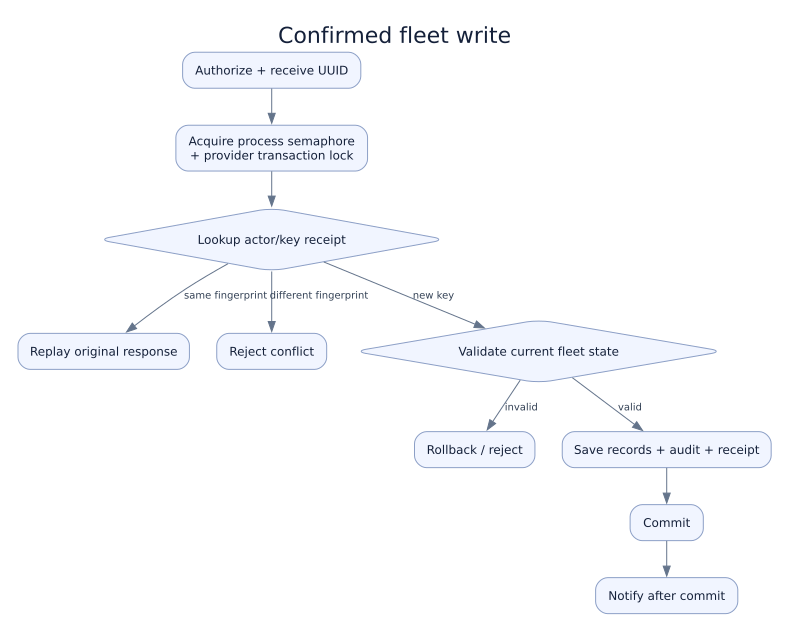

# API contract and integration guide

[Engineering index](README.md) · [Русский](api.ru.md) · [Project README](../../README.md)

**Baseline:** V6.3 Enterprise; verified public revision [`f2cea2b`](https://github.com/ViolettaNcl/FleetManagement/commit/f2cea2bfe5334fed0e056feb142e56db8fc470c0). The handbook describes the modern edition; version-specific documents elsewhere in docs/ remain historical or specialist references.

## 1. Transport and authorization

Local base URL: http://127.0.0.1:5095. The same-origin console is /console. API paths are JSON unless an endpoint returns a downloadable workbook. OpenAPI is available at /openapi/v1.json to an authorized client. A 15-minute opaque Identity bearer token is not a JWT. Authenticate with Authorization: Bearer or use the separate X-Fleet-Key automation credential; never expose keys in browser code.

| Principal | Read | Fleet write | Admin accounts/audit |
| --- | --- | --- | --- |
| Admin | Yes | Yes | Yes |
| Dispatcher | Yes | Yes | No |
| Viewer | Yes | No | No |
| Automation | Yes | Yes | No |

Account role changes and revocation are restricted by server policy. Admin can manage staff roles, not create new admins via the public API. Login is rate limited; self-revocation changes the security stamp. Logout alone clears client state.

## 2. Endpoint inventory

Abbreviated paths after commas share the prefix of the first path in that row. DTO field requirements and status details are defined by the actual OpenAPI schema and endpoint code.

| Method | Path | Policy |
| --- | --- | --- |
| GET | /health, /ready | Public |
| GET | /openapi/v1.json | Read |
| POST | /api/auth/login | Public, throttled |
| GET | /api/auth/me | Read |
| POST | /api/auth/revoke-sessions | Authenticated user |
| GET | /api/fleet, /api/vehicles, /api/drivers, /api/trips | Read |
| GET | /api/vehicles/{id}, /api/drivers/{id}, /api/trips/{id} | Read |
| POST | /api/vehicles, /api/drivers, /api/trips | Write |
| PUT, DELETE | /api/vehicles/{id}, /api/drivers/{id}, /api/trips/{id} | Write |
| GET | /api/dispatch/recommend, /api/maintenance | Read |
| POST | /api/vehicles/{id}/service | Write |
| GET | /api/operations/policy, /revision, /overview, /calendar, /scheduled-review | Read |
| GET | /api/operations/maintenance, /shifts, /reservations | Read |
| POST | /api/operations/maintenance, /shifts, /reservations | Write |
| DELETE | /api/operations/shifts/{id}, /reservations/{id} | Write |
| POST | /api/operations/batch/preview, /apply | Write |
| GET | /api/reports/summary, /excel | Read |
| POST | /api/reports/finance/summary, /excel | Read |
| GET | /api/admin/users, /audit, /receipt-capacity | Admin |
| POST | /api/admin/users, /api/admin/users/{id}/revoke-sessions | Admin |
| PUT | /api/admin/users/{id}/role | Admin |
| SignalR | /hubs/fleet | Read |

Calendar: from=YYYY-MM-DD, days=1–31. Trip reports: from/to inclusive UTC departure dates, up to 366 days. Recommendation start/end use ISO 8601 offsets. Finance POST reads data and does not mutate records.

## 3. Safe integration example

Start the local server with the documented launcher; obtain a credential authorized for the operation. In PowerShell, with an existing temporary token stored only in the current process variable:

~~~powershell
$base = 'http://127.0.0.1:5095'
$headers = @{ Authorization = "Bearer $token" }
Invoke-RestMethod "$base/health"
Invoke-RestMethod "$base/api/operations/overview" -Headers $headers
Invoke-RestMethod "$base/api/operations/calendar?from=2026-11-27&days=7" -Headers $headers
~~~

The example date is fixed for reproducibility. Use the actual required period. Do not paste credentials into public issue logs or commit them.

## 4. Write contract

Generate a UUID before the first confirmed write. Send Idempotency-Key in D format. Preserve the exact typed request, method, path and key until the outcome is known. A same-key/same-payload replay returns the original success result (with Idempotency-Replayed: true); changing the operation or payload returns conflict. Successful headerless requests also consume receipt capacity, but a lost response hides the server-generated key from the client. Identity mutations and read-only reports are outside this fleet receipt contract.

| HTTP result | Client action |
| --- | --- |
| 2xx | Confirm success; refresh authoritative state |
| 400 | Correct validation error before resubmission |
| 401 / 403 | Reauthenticate or request appropriate role; never escalate locally |
| 404 | Re-fetch references; verify route and ID |
| 409 | Reconcile stale/conflicting data or receipt capacity; no blind retry |
| 429 | Respect login throttling; back off |
| 503 / network uncertainty | For confirmed fleet writes retry only the original key/body, or inspect records |

Batch preview does not authorize or reserve resources. Confirmed apply revalidates the submitted subset under the write lock; no partial success on conflicting assignments.

## 5. Realtime, readiness and contracts

FleetChanged signals a committed mutation with a UTC timestamp, not a data stream. Re-fetch records with authorization. Realtime is best effort, and revision polling is the connected console fallback. Existing sessions and in-flight requests may outlive revocation until expiry/completion. Health does not prove database readiness; use /ready too. No public backend deployment or production SLA is claimed.

**Source:** [Program](../../src/FleetManagement.Api/Program.cs), [fleet endpoints](../../src/FleetManagement.Api/FleetEndpoints.cs), [operations](../../src/FleetManagement.Api/OperationsEndpoints.cs), [identity](../../src/FleetManagement.Api/IdentityEndpoints.cs), [finance](../../src/FleetManagement.Api/FinancialEndpoints.cs), [overview](../../src/FleetManagement.Api/OverviewEndpoints.cs), [detailed receipts](../batch-receipts.md), [backend guide](../backend.md).

## Visual evidence

[All diagrams](../visuals/diagrams.md) · [Gallery](../visuals/gallery.md)
