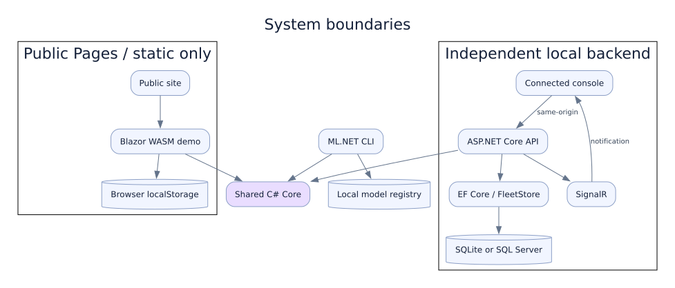

# Architecture, boundaries and data integrity

**English** · [Русский](architecture.ru.md)

[Project README](../../README.md) · [Handbook index](README.md) · [Visual evidence](../visuals/README.md)

**Baseline:** V6.3 Enterprise; verified public revision [`f2cea2b`](https://github.com/ViolettaNcl/FleetManagement/commit/f2cea2bfe5334fed0e056feb142e56db8fc470c0). The handbook describes the modern edition; version-specific documents elsewhere in docs/ remain historical or specialist references.

**On this page**

- [1. Runtime boundaries](#1-runtime-boundaries)
- [2. Logical persistence](#2-logical-persistence)
- [3. Transaction and failure model](#3-transaction-and-failure-model)
- [4. Invariants and time](#4-invariants-and-time)
- [5. Decisions and evolution](#5-decisions-and-evolution)
- [Visual evidence](#visual-evidence)

## 1. Runtime boundaries

| Component | Responsibility | Persistent state |
| --- | --- | --- |
| Core | Shared deterministic domain and analytical functions | None owned |
| Web | Standalone Blazor WASM presentation | Browser localStorage, synthetic snapshots and preferences |
| API | Minimal API, authorization, write orchestration and embedded console | EF Core database; optional scheduled review history |
| Console | Same-origin HTML/CSS/JS; user interactions | Access token and pending requests in memory |
| ML.NET trainer | Independent local training, reload and evaluation | Versioned filesystem experiment artifacts |
| Public site | Static pages, SEO and app packaging | Published files only |
| Legacy WPF | Historical implementation | Independent legacy database/configuration |

Dependency direction: Web, API and ModelTrainer reference Core. Core does not reference EF, UI or trainer. Do not introduce a browser-to-database connection or put credentials in the Web project.

~~~mermaid
flowchart TB
  B[Browser demo] --> C[Core]
  B --> LS[(Local storage)]
  U[Connected console] -->|HTTPS in a hardened deployment / local HTTP| A[API]
  A --> C
  A --> S[FleetStore]
  S --> D[(EF Core provider)]
  A --> H[SignalR]
  T[Model trainer] --> C
  T --> R[(Local registry)]
~~~

## 2. Logical persistence

~~~mermaid
erDiagram
  VEHICLE ||--o{ TRIP : assigned
  DRIVER ||--o{ TRIP : assigned
  VEHICLE ||--o{ MAINTENANCE_ENTRY : history
  VEHICLE ||--o{ VEHICLE_RESERVATION : availability
  DRIVER ||--o{ DRIVER_SHIFT : coverage
~~~

Vehicle plate and driver license are unique. Related records have restrictive foreign keys. AuditEntry and BatchReceipt retain logical historical references; they are not cascading operational entity links. Identity tables store users and role memberships separately.

## 3. Transaction and failure model

1. Authentication and endpoint policy are evaluated.
2. FleetStore acquires a process semaphore and a provider transaction: SQLite writer reservation or SQL Server transaction-owned exclusive sp_getapplock.
3. Read current records, look up actor-scoped idempotency receipt, and validate domain invariants inside the lock. Optional expected-record comparison prevents overwriting an observed version on supported operations.
4. Save operational changes, audit and receipt in the same transaction. Non-success responses roll back.
5. Commit before sending best-effort change notifications. A lost response is not proof of rollback: retry only the same key and payload.

Direct SQL, older APIs and other non-cooperating writers bypass this protocol. Do not run them concurrently. Read queries are not a guaranteed global snapshot. SignalR is not a durable event bus; console revision polling complements it. No distributed backplane or transactional outbox exists.

## 4. Invariants and time

- Start/end and reservation/shift windows are validated; overlapping assignments and unavailable vehicles are rejected under the current policy.
- Strict shift coverage is optional (Fleet__RequireShifts); it does not retroactively alter records.
- API accepts offset-aware dates and normalizes to UTC. The standalone demo has its own simulation clock.
- Recorded work and service interval reset are separate from reservations. Report estimates do not equal invoices or accounting records.
- Receipt capacity is 50,000; retain receipts until a reviewed policy migration. Do not truncate them to reclaim space.

## 5. Decisions and evolution

| Decision | Consequence |
| --- | --- |
| ADR-001: independent static demo | Recruiter-friendly entry without secrets; no automatic API synchronization |
| ADR-002: shared pure Core | Business rules reusable across frontends, independently testable |
| ADR-003: provider-level serialization | Correctness for cooperating writers; bounded throughput and retry considerations |
| ADR-004: explicit synthetic ML boundary | Reproducible experiments, no safety or production accuracy assertion |
| ADR-005: explicit schema upgrade | Existing V2 data is not automatically migrated or reset |
| ADR-006: native XLSX/print | Local reporting; literal user text and no proprietary runtime requirement |

The legacy WPF solution is not the modern API, and it does not use this Core. Production adoption needs migration history, operational monitoring, recovery drills, proper secrets, HTTPS, real-data validation and security review.

**Source:** [Core](../../src/FleetManagement.Core), [API](../../src/FleetManagement.Api), [FleetStore](../../src/FleetManagement.Api/FleetStore.cs), [EF mapping](../../src/FleetManagement.Api/FleetDbContext.cs), [concurrency](../database-concurrency.md), [receipts](../batch-receipts.md), [historical ADRs](../architecture.md).

Detailed fields, boundary cases and write sequence: [domain specification](domain.md).

## Visual evidence

[All diagrams](../visuals/diagrams.md) · [Gallery](../visuals/gallery.md)

---

[Project README](../../README.md) · [Handbook index](README.md) · [Русский](architecture.ru.md)
