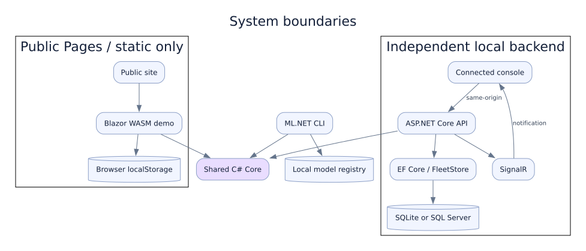

# Архитектура, границы компонентов и целостность данных

**Русский** · [English](architecture.md)

[README проекта](../../README.ru.md) · [Оглавление руководства](README.ru.md) · [Визуальные материалы](../visuals/README.ru.md)

**Базовая версия:** V6.3 Enterprise; подтверждённая публичная ревизия [`f2cea2b`](https://github.com/ViolettaNcl/FleetManagement/commit/f2cea2bfe5334fed0e056feb142e56db8fc470c0). Руководство описывает современную версию; документы предыдущих версий в docs/ сохраняются как исторические и специализированные материалы.

**На этой странице**

- [1. Границы исполнения](#1-границы-исполнения)
- [2. Логическая модель данных](#2-логическая-модель-данных)
- [3. Транзакционная модель и отказы](#3-транзакционная-модель-и-отказы)
- [4. Инварианты и время](#4-инварианты-и-время)
- [5. Решения и развитие](#5-решения-и-развитие)
- [Визуальные материалы](#визуальные-материалы)

## 1. Границы исполнения

| Компонент | Ответственность | Хранение |
| --- | --- | --- |
| Core | Общие детерминированные доменные и аналитические функции | Не владеет состоянием |
| Web | Автономный Blazor WASM | localStorage, синтетические снимки и настройки |
| API | Minimal API, авторизация, запись, встроенная консоль | EF Core; опциональная история плановых проверок |
| Console | HTML/CSS/JS того же origin, взаимодействие с пользователем | Токен и ожидающие запросы в памяти |
| ML.NET Trainer | Отдельное локальное обучение, перезагрузка и оценка | Версионированные артефакты на диске |
| Public site | Статические страницы, SEO и упаковка приложения | Только опубликованные файлы |
| Legacy WPF | Историческая реализация | Независимая старая БД и конфигурация |

Направление зависимостей: Web, API и ModelTrainer используют Core. Ядро не зависит от EF, UI и Trainer. Нельзя подключать браузер напрямую к БД или помещать секреты в Web.

~~~mermaid
flowchart TB
  B[Автономное демо] --> C[Core]
  B --> LS[(Хранилище браузера)]
  U[Подключённая консоль] -->|Локальный HTTP / HTTPS после hardening| A[API]
  A --> C
  A --> S[FleetStore]
  S --> D[(EF Core)]
  A --> H[SignalR]
  T[Model Trainer] --> C
  T --> R[(Локальный реестр)]
~~~

## 2. Логическая модель данных

~~~mermaid
erDiagram
  VEHICLE ||--o{ TRIP : assigned
  DRIVER ||--o{ TRIP : assigned
  VEHICLE ||--o{ MAINTENANCE_ENTRY : history
  VEHICLE ||--o{ VEHICLE_RESERVATION : availability
  DRIVER ||--o{ DRIVER_SHIFT : coverage
~~~

Регистрационный номер и номер водительского удостоверения уникальны. Связанные записи защищены внешними ключами с запретом каскадного удаления. AuditEntry и BatchReceipt содержат логические исторические ссылки, а не каскадные связи с операционными сущностями. Таблицы Identity отдельно хранят пользователей и роли.

## 3. Транзакционная модель и отказы

1. Проверяются аутентификация и политика эндпоинта.
2. FleetStore захватывает семафор процесса и транзакцию провайдера: резервирование записи SQLite либо эксклюзивный sp_getapplock уровня транзакции SQL Server.
3. Внутри блокировки читаются актуальные записи, проверяются квитанция идемпотентности по субъекту и инварианты. Поддерживаемые операции могут сравнить ожидаемые значения записи для защиты от перезаписи.
4. Операционные изменения, аудит и квитанция сохраняются в общей транзакции. Неуспешный ответ откатывается.
5. Уведомление отправляется после commit по принципу best effort. Потеря ответа не доказывает откат: повторяйте только тот же ключ и тело.

Прямой SQL, старые API и сторонние писатели обходят протокол. Нельзя запускать их одновременно. Чтение не гарантирует единый глобальный снимок. SignalR не является долговечной шиной событий; консоль дополнительно опрашивает ревизию. Распределённого backplane и transactional outbox нет.

## 4. Инварианты и время

- Проверяются начало/конец рейсов и интервалы резервирования/смен; пересекающиеся назначения и недоступный транспорт отклоняются с учётом политики.
- Строгое покрытие сменами опционально (Fleet__RequireShifts); существующие записи не меняются ретроспективно.
- API принимает даты со смещением и приводит к UTC. Автономное демо использует собственные часы симуляции.
- Выполненные работы и сброс интервала ТО не равны резервированию. Расчётные отчёты не являются счетами или бухгалтерскими документами.
- Ёмкость квитанций — 50 000; хранить до согласованного изменения политики. Не очищать таблицу ради освобождения места.

## 5. Решения и развитие

| Решение | Следствие |
| --- | --- |
| ADR-001: независимое статическое демо | Вход без секретов; нет автоматической синхронизации с API |
| ADR-002: общее чистое ядро | Повторное использование и независимое тестирование правил |
| ADR-003: сериализация на уровне провайдера | Целостность для участвующих писателей; ограничения пропускной способности |
| ADR-004: граница синтетического ML | Воспроизводимые эксперименты без утверждений о безопасности и реальной точности |
| ADR-005: явное обновление схемы | V2 не мигрируется и не сбрасывается автоматически |
| ADR-006: нативный XLSX/печать | Локальные отчёты, пользовательский текст как данные, без проприетарного runtime |

Старое решение WPF не является современным API и не использует это ядро. Для промышленного внедрения нужны история миграций, мониторинг, проверяемое восстановление, управление секретами, HTTPS, валидация реальных данных и аудит безопасности.

**Исходники:** [Core](../../src/FleetManagement.Core), [API](../../src/FleetManagement.Api), [FleetStore](../../src/FleetManagement.Api/FleetStore.cs), [EF mapping](../../src/FleetManagement.Api/FleetDbContext.cs), [конкурентность](../database-concurrency.md), [квитанции](../batch-receipts.md), [история ADR](../architecture.md).

Подробные поля, границы и последовательность записи: [доменная спецификация](domain.ru.md).

## Визуальные материалы

[Все диаграммы](../visuals/diagrams.ru.md) · [Галерея](../visuals/gallery.ru.md)

---

[README проекта](../../README.ru.md) · [Оглавление руководства](README.ru.md) · [English](architecture.md)
