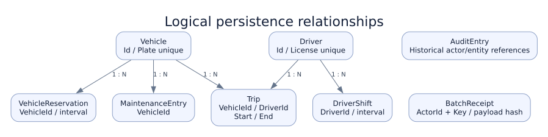

# Доменная спецификация и контракты целостности

[Инженерный индекс](README.ru.md) · [English](domain.md)

**Область:** FleetManagement.Core и согласованные писатели современного API V6.3. Нормативный источник — исполняемый код; примеры синтетические. Документ не вводит новые функции.

## 1. Словарь данных

| Запись | Поле | Тип / инвариант |
| --- | --- | --- |
| Vehicle | Id | int; серверный ID независим от госномера |
| Vehicle | Plate, Model | непустые строки; уникальность Plate в Core без учёта регистра/крайних пробелов |
| Vehicle | Mileage, LastServiceMileage | int км; неотрицательные; пробег ТО ≤ текущего |
| Vehicle | LastService | DateTime; дата не позже часов проверки, год ≥ 1900 |
| Vehicle | ServiceIntervalKm | int, 1–1 000 000 |
| Vehicle | ServiceIntervalDays | int, 1–3650 |
| Driver | Id, Name, License | int ID; непустые имя/удостоверение; нормализованная уникальность License в Core |
| Driver | Experience | int лет, 0–70 |
| Trip | Id, VehicleId, DriverId | int; транспорт и водитель существуют |
| Trip | Origin, Destination | непустые строки |
| Trip | Start, End | DateTime; End строго позже Start |
| Trip | Distance, Track | int; положительная дистанция; Track — метаданные симуляции, не GPS |
| FleetData | Vehicles, Drivers, Trips | коллекции; Core не владеет БД |

Входные HTTP DTO используют DateTimeOffset и перевод в UTC. Expected в поддерживаемых обновлениях — необязательное сравнение записи, не HTTP ETag. Дополнительные ограничения проверяются в эндпоинтах/OpenAPI.

## 2. Временные инварианты

Занятость рейсом — полуоткрытый интервал [start, end). Два разных назначения пересекаются тогда и только тогда, когда:

~~~text
existing.Start < proposed.End AND proposed.Start < existing.End
~~~

Конфликт возникает при совпадении машины ИЛИ водителя. Завершение рейса в 11:00 и начало другого в 11:00 не пересекаются. При обновлении исключается собственный ID. Сервер дополнительно проверяет резервирования и смены. Часы симуляции не равны серверным часам.

~~~mermaid
stateDiagram-v2
  [*] --> Scheduled
  Scheduled --> InTransit: now >= start
  InTransit --> Completed: now >= end
~~~

Статус вычисляется, а не хранится как изменяемый флаг жизненного цикла. Core разрешает менять/удалять только будущие рейсы (start > now). Прогресс — ограниченная доля прошедшего времени от длительности; при некорректной длительности ноль. Это симуляция расписания, не наблюдаемое завершение.

## 3. Таблица решений ТО

remainingKm = intervalKm − max(0, mileage − lastServiceMileage).  
remainingDays = date(lastService + intervalDays) − date(today).

| Условие (по порядку) | Результат |
| --- | --- |
| remainingKm ≤ 0 ИЛИ remainingDays ≤ 0 | Due |
| иначе remainingKm ≤ 1000 ИЛИ remainingDays ≤ 14 | Soon |
| иначе | Healthy |

Это операционные правила, не диагностика. Точные пороговые значения включаются в соответствующий статус. Core исключает Due и занятые ресурсы, сортирует машины по минимальному пробегу и ID, водителей — по количеству рейсов и ID. При отсутствии пары возвращает null. Политики API могут добавлять ограничения.

## 4. Транзакция и повтор

~~~mermaid
sequenceDiagram
  participant C as Клиент
  participant A as Авторизованный API
  participant S as FleetStore
  participant D as БД
  participant H as SignalR
  C->>A: Подтверждённая запись + UUID
  A->>S: Проверенная личность и запрос
  S->>D: Блокировка транзакции провайдера
  S->>D: Квитанция и актуальные записи
  alt Совпадает fingerprint
    S-->>C: Исходный ответ; replay header
  else Другой fingerprint или невалидное состояние
    S-->>C: Конфликт / ошибка валидации
  else Новая допустимая операция
    S->>D: Записи, аудит, квитанция; commit
    S-->>H: Best-effort уведомление
    S-->>C: Успешный ответ
  end
~~~

Область actor/key общая для поддерживаемых обычных и batch-записей. Ограничение ответа квитанции — 65 536 символов по проверке FleetStore; максимум 50 000 записей. Неуспешная валидация откатывается и не расходует ключ. Удаление защищает историю рейсов и работ. Прямой SQL обходит доменную блокировку; совместимость нескольких писателей со старым API не заявляется.

## 5. Acceptance-сценарии

| Вход | Ожидание |
| --- | --- |
| Тот же номер в другом регистре/с пробелами | Core отклоняет дубликат |
| Пробег ТО больше текущего | Отклонить |
| Стаж 70 / 71 | Допустимая граница / отклонить |
| Конец равен началу | Отклонить |
| Смежные рейсы тех же ресурсов | Нет пересечения |
| Пересечение одного водителя на разных машинах | Отклонить |
| Изменение начатого рейса | Отклонить |
| Остаток ТО 1000 км / 14 дней | Soon, если не Due |
| Тот же ключ/тело подтверждённой записи | Исторический ответ без второй записи |
| Тот же ключ, другое тело | Конфликт |

См. [Fleet.cs](../../src/FleetManagement.Core/Fleet.cs), [FleetStore](../../src/FleetManagement.Api/FleetStore.cs), [FleetEndpoints](../../src/FleetManagement.Api/FleetEndpoints.cs), [EF mapping](../../src/FleetManagement.Api/FleetDbContext.cs), [квитанции](../batch-receipts.md), [Core checks](../../tests/FleetManagement.Core.Checks/Program.cs).

## Визуальные материалы

[Все диаграммы](../visuals/diagrams.ru.md) · [Галерея](../visuals/gallery.ru.md)
