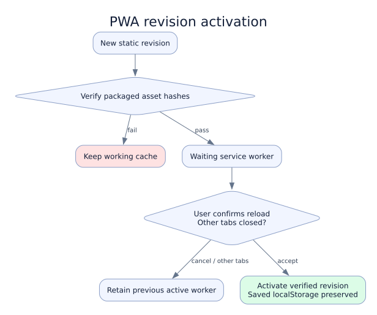

# Frontend architecture and design system

**English** · [Русский](frontend.ru.md)

[Project README](../../README.md) · [Handbook index](README.md) · [Visual evidence](../visuals/README.md)

**Baseline:** V6.3 Enterprise; verified public revision [`f2cea2b`](https://github.com/ViolettaNcl/FleetManagement/commit/f2cea2bfe5334fed0e056feb142e56db8fc470c0). The handbook describes the modern edition; version-specific documents elsewhere in docs/ remain historical or specialist references.

**On this page**

- [1. Three independently styled surfaces](#1-three-independently-styled-surfaces)
- [2. Workspace and styling](#2-workspace-and-styling)
- [3. Approved artwork contract](#3-approved-artwork-contract)
- [4. Responsive and accessible behavior](#4-responsive-and-accessible-behavior)
- [5. Offline and deployment](#5-offline-and-deployment)
- [Visual evidence](#visual-evidence)

## 1. Three independently styled surfaces

| Surface | Implementation | Entry point |
| --- | --- | --- |
| Browser demo | Blazor WASM, Razor components, shared C# rules | /app/ on Pages; local root on dev server |
| Connected console | Embedded HTML, JS, CSS; same-origin API | /console on local API |
| Public product site | Generated static HTML + CSS, EN/RU | / and /ru/ on Pages |

Do not import console credentials or server routes into the static demo. The console uses a restrictive CSP; no external UI libraries or inline script workarounds.

## 2. Workspace and styling

App.razor owns navigation, preferences, demo state and orchestration. Focused Razor views own module presentation. Core owns domain calculations. DemoLocale handles UI labels; some technical terms and generated data remain English. Essentials exposes everyday tasks; All tools reveals all 26 modules and global search can find modules in either mode. User preferences remain local.

Style layers: fleet.css (base), workspace.css (layout and workspace), neon.css/atlas.css (visual refinements), fleet-approved.css (asset integration), fleet-enterprise.css (V6.3 system). Preserve Classic, both themes, density settings and mobile controls. Use the existing semantic tokens, not arbitrary hex colors in domain views. Obsidian and violet establish hierarchy; cyan, amber and red indicate meaning, never color alone.

## 3. Approved artwork contract

| Resource | Location under wwwroot/assets |
| --- | --- |
| Brand and social artwork | brand/ |
| Dashboard and abstract visuals | heroes/ |
| Operational modules | operations/ |
| ML and assistant | intelligence/ |
| Analytics and reports | analytics/ |
| Vehicle models and driver avatar | vehicles/ |
| Empty, startup and offline states | system/ |

AssetRegistry.cs is the central allowlist for module assets and normalized vehicle-model resolution. ModuleHeroBanner.razor, VehicleImage.razor and DriverAvatar.razor are reusable display components. Unknown vehicle models use the default asset. Images are decorative where adjacent text already conveys meaning. Do not infer identity or data from concept illustrations.

The 36 WebP files and three derived PNG icons are committed. Original PNGs remain in the owner archive. Manifest: [fleet-approved-assets.json](../fleet-approved-assets.json); [full render map](../fleet-approved-assets.md). Do not re-generate or duplicate approved originals. Preserve file paths and update byte hashes/metadata when a reviewed asset changes. The legacy neon manifest is separate (ten assets).

## 4. Responsive and accessible behavior

Desktop table/card selection and mobile responsive modes are deliberate. Preserve keyboard navigation, visible focus, native accessible names, text alternatives, reduced-motion preference, readable semantic statuses and scrollable table regions. Do not resolve layout defects by globally hiding overflow; check actual content widths. New module banners may depend on navigation mode. An image in a hidden alternative layout is not evidence that the visible card failed.

Test 320/390/768/1440px in Enterprise coverage, RU switch, both themes, image decoding and HTTP failures. Existing axe and cross-browser suites cover additional scenarios. Automated checks do not certify full WCAG compliance or physical-device performance.

## 5. Offline and deployment

The PWA worker is scoped to /app/. It verifies packaged hashes before activation and retains the prior cache on a failed install. Saved demo data lives in localStorage; unsaved form edits can be lost on reload. Close other demo tabs before approving an update, and export a snapshot before troubleshooting. Do not clear browser site data as a first step. The connected console is not covered by the worker.

**Source:** [App](../../src/FleetManagement.Web/App.razor), [AssetRegistry](../../src/FleetManagement.Web/AssetRegistry.cs), [banner component](../../src/FleetManagement.Web/ModuleHeroBanner.razor), [styles](../../src/FleetManagement.Web/wwwroot/css), [console](../../src/FleetManagement.Api/Console), [site](../../site), [PWA](../pwa-v4.md), [Enterprise test](../../tests/browser/v63-enterprise.mjs).

## Visual evidence

[All diagrams](../visuals/diagrams.md) · [Gallery](../visuals/gallery.md)

---

[Project README](../../README.md) · [Handbook index](README.md) · [Русский](frontend.ru.md)
