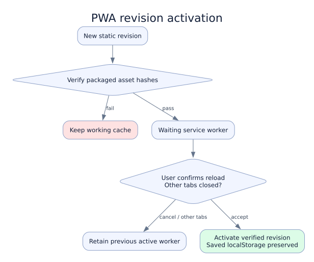

# Frontend-архитектура и дизайн-система

**Русский** · [English](frontend.md)

[README проекта](../../README.ru.md) · [Оглавление руководства](README.ru.md) · [Визуальные материалы](../visuals/README.ru.md)

**Базовая версия:** V6.3 Enterprise; подтверждённая публичная ревизия [`f2cea2b`](https://github.com/ViolettaNcl/FleetManagement/commit/f2cea2bfe5334fed0e056feb142e56db8fc470c0). Руководство описывает современную версию; документы предыдущих версий в docs/ сохраняются как исторические и специализированные материалы.

**На этой странице**

- [1. Три независимых интерфейса](#1-три-независимых-интерфейса)
- [2. Рабочее пространство и стили](#2-рабочее-пространство-и-стили)
- [3. Контракт утверждённых изображений](#3-контракт-утверждённых-изображений)
- [4. Адаптивность и доступность](#4-адаптивность-и-доступность)
- [5. Offline и публикация](#5-offline-и-публикация)
- [Визуальные материалы](#визуальные-материалы)

## 1. Три независимых интерфейса

| Интерфейс | Реализация | Точка входа |
| --- | --- | --- |
| Браузерное демо | Blazor WASM, Razor, общие правила C# | /app/ на Pages; корень локального dev-сервера |
| Подключённая консоль | Встроенные HTML, JS, CSS; same-origin API | /console локального API |
| Публичный сайт | Генерируемые статические HTML и CSS, EN/RU | / и /ru/ на Pages |

Не переносите учётные данные консоли и серверные вызовы в статическое демо. У консоли строгая CSP; не добавляйте внешние UI-библиотеки и обходы через inline scripts.

## 2. Рабочее пространство и стили

App.razor управляет навигацией, настройками, состоянием демо и оркестрацией. Отдельные Razor views отвечают за представление модулей. Core выполняет доменные расчёты. DemoLocale переводит UI; часть технических терминов и сгенерированных данных остаётся на английском. «Основное» показывает ежедневные задачи; «Все инструменты» — 26 разделов, поиск работает в обоих режимах. Настройки сохраняются локально.

Слои CSS: fleet.css (база), workspace.css (компоновка), neon.css/atlas.css (визуальные уточнения), fleet-approved.css (изображения), fleet-enterprise.css (V6.3). Сохраняйте Classic, обе темы, плотность и мобильное управление. Используйте существующие семантические токены вместо произвольных hex в доменных представлениях. Obsidian и фиолетовый формируют иерархию; cyan, amber и red обозначают смысл вместе с текстом.

## 3. Контракт утверждённых изображений

| Ресурс | Каталог внутри wwwroot/assets |
| --- | --- |
| Бренд и social artwork | brand/ |
| Dashboard и абстрактные изображения | heroes/ |
| Операционные разделы | operations/ |
| ML и ассистент | intelligence/ |
| Аналитика и отчёты | analytics/ |
| Модели автомобилей и аватар | vehicles/ |
| Empty/startup/offline | system/ |

AssetRegistry.cs — центральный allowlist баннеров и нормализованный выбор модели автомобиля. ModuleHeroBanner.razor, VehicleImage.razor и DriverAvatar.razor — переиспользуемые компоненты отображения. Для неизвестной модели используется fallback. Декоративные изображения не дублируют соседний информативный текст. Концептуальные иллюстрации не содержат подтверждённых данных о реальной эксплуатации.

36 WebP и три производные PNG-иконки сохранены в Git. Оригиналы PNG находятся в архиве владельца. Манифест: [fleet-approved-assets.json](../fleet-approved-assets.json); [полная карта отображения](../fleet-approved-assets.md). Не регенерируйте и не дублируйте утверждённые оригиналы. При согласованном изменении ресурса обновляйте хеши/метаданные и сохраняйте пути. Старый neon-манифест отдельный (десять файлов).

## 4. Адаптивность и доступность

Выбор desktop-таблицы/карточек и мобильного режима — осознанное поведение. Сохраняйте клавиатурную навигацию, видимый фокус, доступные имена, текстовые альтернативы, reduced motion, читаемые статусы и прокрутку таблиц. Не скрывайте глобально overflow вместо исправления компоновки. Баннер может зависеть от режима навигации. Изображение в скрытом альтернативном представлении не доказывает дефект видимой карточки.

Enterprise-тест проверяет 320/390/768/1440 px, переключение RU, обе темы, декодирование и HTTP-ошибки. Остальные axe/cross-browser тесты охватывают дополнительные сценарии. Автоматические проверки не подтверждают полное соответствие WCAG и скорость на физическом устройстве.

## 5. Offline и публикация

PWA worker ограничен /app/. Проверяет хеши файлов перед активацией и сохраняет старый кэш при сбое установки. Записи демо находятся в localStorage; несохранённые правки могут потеряться при перезагрузке. Перед согласованным обновлением закройте другие вкладки демо и экспортируйте снимок. Не очищайте данные сайта первым действием при диагностике. Серверная консоль не входит в scope worker.

**Исходники:** [App](../../src/FleetManagement.Web/App.razor), [AssetRegistry](../../src/FleetManagement.Web/AssetRegistry.cs), [баннер](../../src/FleetManagement.Web/ModuleHeroBanner.razor), [стили](../../src/FleetManagement.Web/wwwroot/css), [консоль](../../src/FleetManagement.Api/Console), [сайт](../../site), [PWA](../pwa-v4.md), [Enterprise-тест](../../tests/browser/v63-enterprise.mjs).

## Визуальные материалы

[Все диаграммы](../visuals/diagrams.ru.md) · [Галерея](../visuals/gallery.ru.md)

---

[README проекта](../../README.ru.md) · [Оглавление руководства](README.ru.md) · [English](frontend.md)
