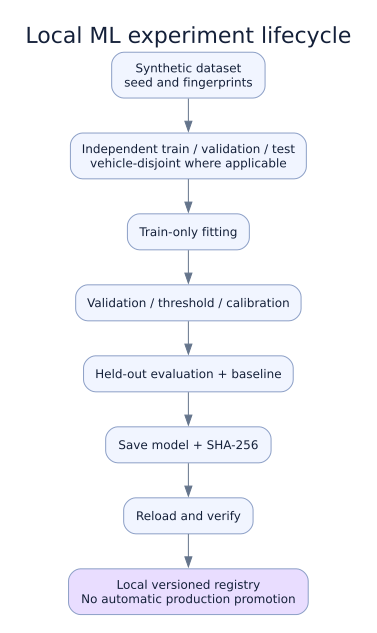
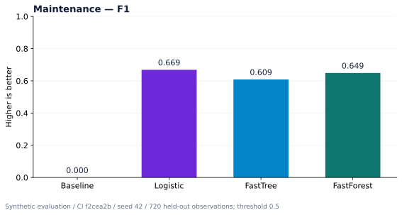

# Machine learning, optimization and evaluation

**English** · [Русский](intelligence.ru.md)

[Project README](../../README.md) · [Handbook index](README.md) · [Visual evidence](../visuals/README.md)

**Baseline:** V6.3 Enterprise; verified public revision [`f2cea2b`](https://github.com/ViolettaNcl/FleetManagement/commit/f2cea2bfe5334fed0e056feb142e56db8fc470c0). The handbook describes the modern edition; version-specific documents elsewhere in docs/ remain historical or specialist references.

**On this page**

- [1. Separate decision layers](#1-separate-decision-layers)
- [2. Experimental model contracts](#2-experimental-model-contracts)
- [3. Reproducible trainer run](#3-reproducible-trainer-run)
- [4. Evaluation and governance protocol](#4-evaluation-and-governance-protocol)
- [5. Specialist specifications](#5-specialist-specifications)
- [Visual evidence](#visual-evidence)

## 1. Separate decision layers

| Layer | Implementation | Operational meaning |
| --- | --- | --- |
| Rules | FleetAdvisor, service intervals, availability | Deterministic calculations from registered records |
| Optimization | RouteOptimizer, BatchDispatch, MultiVehicleDispatch | Comparison of scenario/assignment strategies; not real-road navigation |
| Synthetic ML | Pure C# browser experiments | Educational validation only |
| Offline training | ML.NET CLI | Persisted experiment artifacts, no server promotion |
| Optional local generative AI | Ollama terminal companion | Explanation of fixed synthetic aggregates; no data or write access |

The browser assistant is a bounded intent engine, not a general LLM. Digital Twin and geographic tracking simulate positions, time and sensor values. No live GPS, real ECU data or route provider.

## 2. Experimental model contracts

| Experiment | Method and evaluation | Key limitation |
| --- | --- | --- |
| Maintenance | Standardized L2 logistic regression; 2,400 training observations across 40 vehicles, 720 test rows across 12 disjoint vehicles | Artificial seven-day failure label, no real diagnostic evidence |
| Ensemble | Fixed logistic members, independent validation threshold with weighted FN/FP, F1/Brier/calibration/ranking on held-out vehicles | Disagreement is not a confidence interval |
| Group validation | Vehicle-disjoint folds, select by validation Brier loss | No test-driven tuning |
| ETA | Linear regression, 1,600/400/400 train/validation/test journeys; MAE/RMSE/R² vs free-flow baseline | Synthetic labels, not live routing |
| Anomalies | Z-score baseline and isolation trees; normal-reference fitting and synthetic injected faults | Not a calibrated real-sensor detector |
| Demand | Chronological holdout and forecast sandbox | No external market or demand data |
| Clustering | Standardized deterministic K-means on mileage/trips/distance | Descriptive cohorts, not a driver/safety ranking |
| Drift | PSI, model-output review and separately evaluated retraining candidates | No automatic production promotion |
| Registry | ML.NET FastTree maintenance/ETA and calibrated FastForest; reload/hash checks | Local files, no model server |

Use metrics appropriate to the task: precision/recall/F1 for threshold behavior, Brier for probability error, ROC-AUC/AP for ranking, MAE/RMSE/R² for ETA. A single-class ranking metric is unavailable, not zero. Validation residual percentiles are not guaranteed conditional prediction intervals. Feature contributions and permutation importance are non-causal.

## 3. Reproducible trainer run

From repository root:

~~~powershell
dotnet run --project tools/FleetManagement.ModelTrainer -c Release -- model-registry 42
~~~

ML.NET 5.0.0 and FastTree 5.0.0 are pinned. The CLI writes a unique staged experiment directory, saves ZIP transformers, reloads and compares outputs, and finalizes a manifest with seed, source revision when available, dataset fingerprints, settings, metrics and hashes. The output directory is ignored by Git. Never load untrusted model archives. Initial package restore needs internet or a package cache; no GPU or paid model API is required.

## 4. Evaluation and governance protocol

1. Freeze seed, splits, feature definitions and metric contract before evaluation.
2. Fit scalers and model parameters on train only; tune on validation only.
3. Group by vehicle where applicable; keep independent test cohorts and chronological holdout for demand.
4. Compare a baseline, report actual metrics and missing metrics, verify reload and artifact hashes.
5. Record known failure modes, data provenance and intended use. No claims of real-world performance without representative field data and independent safety review.

The optional local Ollama CLI is a separate opt-in integration: [local AI guide](../local-ai.md). Model output can hallucinate; it cannot modify fleet records.

## 5. Specialist specifications

[Maintenance card](../maintenance-model-card.md) · [Prediction cards](../prediction-model-cards.md) · [Registry](../model-registry.md) · [Drift](../model-drift.md) · [Data quality](../data-quality.md) · [Economics/forecasting](../economics-and-forecasting.md) · [Digital twin](../digital-twin.md) · [Multi-dispatch](../multi-dispatch.md).

**Source:** [Core algorithms](../../src/FleetManagement.Core), [ModelTrainer](../../tools/FleetManagement.ModelTrainer), [ML tests](../../tests/ml), [ML CI](../../.github/workflows/ml-ci.yml).

Formulas and analytical complexity: [algorithm reference](algorithms.md).

## Visual evidence

[All diagrams](../visuals/diagrams.md) · [Gallery](../visuals/gallery.md)

[ML evidence](../visuals/analytics.md)

---

[Project README](../../README.md) · [Handbook index](README.md) · [Русский](intelligence.ru.md)
