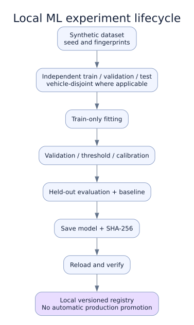
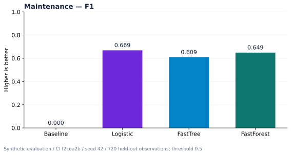

# Машинное обучение, оптимизация и оценка

[Инженерный индекс](README.ru.md) · [English](intelligence.md) · [README проекта](../../README.ru.md)

**Базовая версия:** V6.3 Enterprise; подтверждённая публичная ревизия [`f2cea2b`](https://github.com/ViolettaNcl/FleetManagement/commit/f2cea2bfe5334fed0e056feb142e56db8fc470c0). Руководство описывает современную версию; документы предыдущих версий в docs/ сохраняются как исторические и специализированные материалы.

## 1. Разделение уровней принятия решений

| Уровень | Реализация | Практический смысл |
| --- | --- | --- |
| Правила | FleetAdvisor, интервалы ТО, доступность | Детерминированные расчёты по реестру |
| Оптимизация | RouteOptimizer, BatchDispatch, MultiVehicleDispatch | Сравнение стратегий и сценариев, не дорожная навигация |
| Синтетический ML | Эксперименты на чистом C# в браузере | Только учебная валидация |
| Локальное обучение | CLI ML.NET | Сохранённые артефакты без серверного продвижения |
| Опциональный generative AI | Терминальный помощник Ollama | Объяснение фиксированных синтетических агрегатов без записи и доступа к данным |

Помощник браузера — ограниченный движок намерений, не универсальная LLM. Digital Twin и геотрекинг симулируют координаты, время и показания. Нет реального GPS, ECU и внешнего маршрутизатора.

## 2. Контракты экспериментов

| Эксперимент | Метод и оценка | Ключевое ограничение |
| --- | --- | --- |
| ТО | Стандартизированная L2-логистическая регрессия; 2 400 обучающих наблюдений по 40 машинам, 720 тестовых по 12 другим | Искусственная метка отказа за 7 дней, нет реальной диагностики |
| Ансамбль | Фиксированные логистические модели, порог по независимой валидации с весами FN/FP, F1/Brier/калибровка/ранжирование на тестовых машинах | Разброс моделей не доверительный интервал |
| Групповая валидация | Разделение по машинам, выбор по Brier на validation | Не настраивать на тесте |
| ETA | Линейная регрессия, 1 600/400/400 поездок train/validation/test; MAE/RMSE/R² против free-flow baseline | Синтетические метки, не живой маршрут |
| Аномалии | Z-score и isolation trees; обучение на нормальных образцах и синтетических отказах | Не калиброванный детектор реальных датчиков |
| Спрос | Хронологический holdout и сценарий прогноза | Нет внешних данных рынка |
| Кластеризация | Детерминированный стандартизированный K-means по пробегу/рейсам/дистанции | Описательные группы, не рейтинг водителей и безопасности |
| Дрейф | PSI, анализ выходов и отдельная оценка кандидатов переобучения | Нет автоматического продвижения модели |
| Реестр | ML.NET FastTree ТО/ETA и калиброванный FastForest; перезагрузка и хеши | Локальные файлы, не model server |

Метрики выбираются по задаче: precision/recall/F1 для порога, Brier для ошибки вероятности, ROC-AUC/AP для ранжирования, MAE/RMSE/R² для ETA. Метрика ранжирования при одном классе недоступна, а не равна нулю. Перцентили ошибок валидации не гарантируют условные интервалы прогноза. Вклад признаков и permutation importance не доказывают причинность.

## 3. Воспроизводимое обучение

Из корня репозитория:

~~~powershell
dotnet run --project tools/FleetManagement.ModelTrainer -c Release -- model-registry 42
~~~

ML.NET и FastTree закреплены на 5.0.0. CLI создаёт уникальный временный каталог, сохраняет ZIP-трансформеры, перезагружает их и сравнивает выходы, финализирует манифест с seed, ревизией при наличии, отпечатками выборок, настройками, метриками и хешами. Каталог результатов исключён из Git. Не загружайте недоверенные архивы моделей. Первичный restore требует сети или кэша пакетов; GPU и платный AI API не нужны.

## 4. Протокол оценки и управления моделями

1. До оценки зафиксировать seed, разбиения, признаки и контракт метрик.
2. Обучать scaler и параметры только на train, настраивать только по validation.
3. Разделять машины по группам, сохранять независимый test и хронологический holdout для спроса.
4. Сравнить baseline, опубликовать фактические/недоступные метрики, проверить reload и хеши.
5. Записать ограничения, происхождение данных и назначение. Реальная эффективность требует репрезентативных полевых данных и независимой проверки безопасности.

Опциональный Ollama — отдельная CLI-интеграция: [руководство](../local-ai.md). Ответы могут содержать ошибки; помощник не изменяет записи.

## 5. Специализированные материалы

[Модель ТО](../maintenance-model-card.md) · [Карточки прогнозов](../prediction-model-cards.md) · [Реестр](../model-registry.md) · [Дрейф](../model-drift.md) · [Качество данных](../data-quality.md) · [Экономика и прогнозирование](../economics-and-forecasting.md) · [Digital Twin](../digital-twin.md) · [Multi-dispatch](../multi-dispatch.md).

**Исходники:** [Алгоритмы Core](../../src/FleetManagement.Core), [ModelTrainer](../../tools/FleetManagement.ModelTrainer), [ML-тесты](../../tests/ml), [ML CI](../../.github/workflows/ml-ci.yml).

Формулы и аналитическая сложность: [справочник алгоритмов](algorithms.ru.md).

## Визуальные материалы

[Все диаграммы](../visuals/diagrams.ru.md) · [Галерея](../visuals/gallery.ru.md)

[Результаты ML](../visuals/analytics.ru.md)
