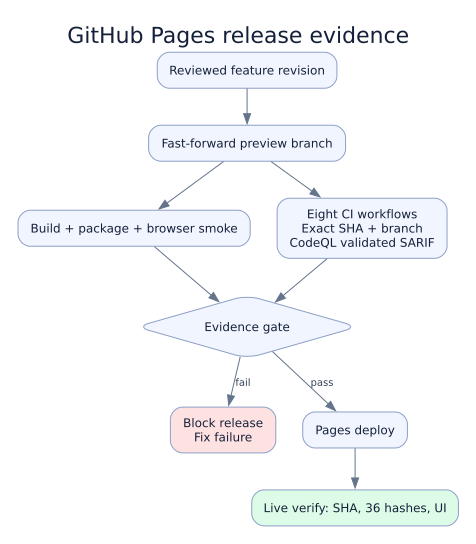

# Local operations, recovery and release runbook

[Engineering index](README.md) · [Русский](operations.ru.md) · [Project README](../../README.md)

**Baseline:** V6.3 Enterprise; verified public revision [`f2cea2b`](https://github.com/ViolettaNcl/FleetManagement/commit/f2cea2bfe5334fed0e056feb142e56db8fc470c0). The handbook describes the modern edition; version-specific documents elsewhere in docs/ remain historical or specialist references.

## 1. Environment

.NET 10 SDK is required for modern projects; PowerShell 7 for the connected launcher; Python 3 and Node.js for packaging and browser tooling. Docker with Compose is optional for SQL Server. The old WPF solution is separate and requires the legacy Windows toolchain.

~~~powershell
git clone --branch feature/approved-fleet-assets https://github.com/ViolettaNcl/FleetManagement.git
cd FleetManagement
dotnet --list-sdks
dotnet run --project src/FleetManagement.Web
~~~

Use the address printed by .NET; do not open a WASM index.html using file://.

### Connected mode

~~~powershell
pwsh -File tools/start-connected.ps1
~~~

The launcher binds to loopback, uses .fleet-local/fleet-v3.db by default, generates a temporary automation key, prompts for a fresh admin password and does not automatically upgrade an existing database. Open http://127.0.0.1:5095/console. To use a nondefault database, supply an explicit supported file path with -DatabasePath. Stop with Ctrl+C.

| Config key | Intent |
| --- | --- |
| Fleet__ApiKey | Local automation credential; random, never tracked |
| Fleet__Provider | Sqlite (default) or SqlServer |
| ConnectionStrings__Fleet | Explicit database connection |
| Fleet__InitializeDatabase | Explicit initialization |
| Fleet__SeedDemo | Synthetic initial records only, opt in |
| Fleet__UpgradeV2Schema | Explicit reviewed upgrade; requires initialization |
| Fleet__RequireShifts | Optional strict driver shift coverage |
| Fleet__BootstrapAdminEmail / Password | Initial administrator only, private |
| Fleet__ScheduledReviewEnabled | Default off; opt-in read-only review |
| Fleet__ScheduledReviewIntervalMinutes | 1–1440 when enabled, default 60 |
| Fleet__ScheduledReviewPath | Absolute private history file when enabled |

Optional review threshold configuration: Fleet__ScheduledReviewHighThreshold, Fleet__ScheduledReviewMediumThreshold and Fleet__ScheduledReviewIncludeMedium. The worker does not send messages or mutate fleet records. Do not share a history path between unrelated processes; the local lock is not a distributed lease.

SQL Server: provision FLEET_API_KEY and MSSQL_SA_PASSWORD securely, then run docker compose -f compose.fleet.yml up --build. API bound to localhost; DB not published on host by default. See [backend](../backend.md).

## 2. Verification and backup

~~~powershell
dotnet run --project tests/FleetManagement.Core.Checks -c Release
dotnet publish src/FleetManagement.Web -c Release -o publish
python tools/test_release_security.py
python tests/browser/test_approved_assets.py
python tests/browser/test_enterprise_contract.py
~~~

For full browser verification follow the exact [demo CI workflow](../../.github/workflows/demo-ci.yml), including asset import, browser dependencies and static subpath. Do not substitute a mock fixture for real WASM tests.

Before schema work: stop all writers, back up, verify and rehearse a restore to a separate file. Example for an existing **stopped V2 SQLite** database (replace paths deliberately):

~~~powershell
python tools/sqlite_recovery.py backup fleet-demo-v2.db fleet-backups/before-v3
python tools/sqlite_recovery.py verify fleet-backups/before-v3
python tools/sqlite_recovery.py restore fleet-backups/before-v3 recovered-test.db
~~~

Never restore on top of a live DB, delete receipts or apply fresh baseline migrations to existing data. SQL Server backup/restore is provider-specific. Review [upgrade](../database-upgrade.md), [recovery](../database-recovery.md) and [receipt capacity](../batch-receipts.md).

## 3. Release flow (Pages)

~~~mermaid
flowchart LR
  F[Reviewed feature commit] --> P[Fast-forward preview branch]
  P --> B[Build and package]
  P --> E[Exact-branch CI evidence]
  B --> D[Pages deploy]
  E --> D
  D --> V[Verify real public revision and assets]
~~~

Publication branch: preview/fleetops-v3. Master is not required for a preview release. GitHub Pages also supports master, so a later master deployment may replace the preview. Require owner approval before moving a publication branch. Never force-push or bypass evidence.

The gate checks eight workflows on the exact branch and SHA; separate CodeQL results or validated clean SARIF from the exact successful workflow attempt are required. On the fallback analysis path, missing evidence, nonzero findings or malformed diagnostics fail closed. Browser checks validate the split public package, and verify-live checks the real URL, revision, 36 approved hashes, visible vehicle art, metadata and offline behavior. A successful build alone does not establish a successful release.

Verified reference: [`f2cea2b`](https://github.com/ViolettaNcl/FleetManagement/commit/f2cea2bfe5334fed0e056feb142e56db8fc470c0), [Pages run](https://github.com/ViolettaNcl/FleetManagement/actions/runs/46058985410). The actual current revision is reported by the public preview-build.json; compare to the intended SHA.

## 4. Incident triage

| Symptom | Check first | Safe action |
| --- | --- | --- |
| /app/ returns 404 | Pages build, deploy and environment policy | Confirm GitHub Actions source and preview branch permission; inspect actual failed job |
| Old design | Published revision vs intended SHA | Complete deployment; then accept PWA update, close extra tabs |
| Missing images | HTTP and SHA-256, visible layout and manifest | Diagnose path/cache; do not regenerate |
| Evidence fails | Exact branch/SHA, latest attempt, CodeQL SARIF and diagnostics | Fix failing checks; no fake status or disabled gate |
| Write outcome uncertain | Original UUID/body and server state | Retry same confirmed request only |
| Database not ready | /ready, configuration and schema | Stop writers, inspect, back up; no destructive initialization |
| Receipt cap | Admin receipt-capacity | Plan reviewed retention migration; no purge |
| PWA update fails | Hash failure/storage/other tabs | Keep previous cache; save/export and retry safely |

## 5. Recovery and release limits

Portable Windows artifact is self-contained, unsigned and synthetic-only. The connected API is not included in the static package. Rollback means redeploying a previously reviewed static revision through an authorized release procedure; do not reset Git history or downgrade a populated database blindly. Record old/new SHA, incident, verification and explicit approval.

**Sources:** [deployment](../deployment.md), [Pages workflow](../../.github/workflows/pages.yml), [release gate](../../tools/release_gate.py), [SARIF checker](../../tools/check_codeql_sarif.py), [launcher](../../tools/start-connected.ps1).

## Visual evidence

[All diagrams](../visuals/diagrams.md) · [Gallery](../visuals/gallery.md)
