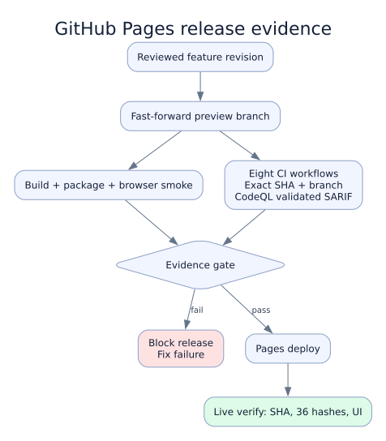

# Локальная эксплуатация, восстановление и регламент релиза

**Русский** · [English](operations.md)

[README проекта](../../README.ru.md) · [Оглавление руководства](README.ru.md) · [Визуальные материалы](../visuals/README.ru.md)

**Базовая версия:** V6.3 Enterprise; подтверждённая публичная ревизия [`f2cea2b`](https://github.com/ViolettaNcl/FleetManagement/commit/f2cea2bfe5334fed0e056feb142e56db8fc470c0). Руководство описывает современную версию; документы предыдущих версий в docs/ сохраняются как исторические и специализированные материалы.

**На этой странице**

- [1. Окружение](#1-окружение)
- [2. Проверки и резервное копирование](#2-проверки-и-резервное-копирование)
- [3. Процедура релиза Pages](#3-процедура-релиза-pages)
- [4. Диагностика инцидентов](#4-диагностика-инцидентов)
- [5. Восстановление и ограничения релиза](#5-восстановление-и-ограничения-релиза)
- [Визуальные материалы](#визуальные-материалы)

## 1. Окружение

Современным проектам нужен .NET 10 SDK; лаунчеру — PowerShell 7; упаковке и браузерным проверкам — Python 3 и Node.js. Docker с Compose опционален для SQL Server. Старое WPF-решение требует отдельного Windows toolchain.

~~~powershell
git clone --branch feature/approved-fleet-assets https://github.com/ViolettaNcl/FleetManagement.git
cd FleetManagement
dotnet --list-sdks
dotnet run --project src/FleetManagement.Web
~~~

Используйте адрес из вывода .NET; WASM index.html нельзя открывать через file://.

### Подключённый режим

~~~powershell
pwsh -File tools/start-connected.ps1
~~~

Лаунчер слушает loopback, использует по умолчанию .fleet-local/fleet-v3.db, генерирует временный automation key, запрашивает новый пароль администратора и не обновляет существующую БД автоматически. Откройте http://127.0.0.1:5095/console. Для другой БД явно укажите допустимый путь через -DatabasePath. Остановка — Ctrl+C.

| Ключ конфигурации | Назначение |
| --- | --- |
| Fleet__ApiKey | Локальный случайный automation credential, не хранится в Git |
| Fleet__Provider | Sqlite (по умолчанию) или SqlServer |
| ConnectionStrings__Fleet | Явное подключение к БД |
| Fleet__InitializeDatabase | Явное создание БД |
| Fleet__SeedDemo | Опциональные синтетические начальные записи |
| Fleet__UpgradeV2Schema | Согласованное обновление; требует initialization |
| Fleet__RequireShifts | Опциональное строгое покрытие сменами |
| Fleet__BootstrapAdminEmail / Password | Только первоначальный Admin, приватно |
| Fleet__ScheduledReviewEnabled | По умолчанию выключено; проверка только для чтения |
| Fleet__ScheduledReviewIntervalMinutes | 1–1440 при включении, по умолчанию 60 |
| Fleet__ScheduledReviewPath | Абсолютный приватный путь истории при включении |

Дополнительные пороги: Fleet__ScheduledReviewHighThreshold, Fleet__ScheduledReviewMediumThreshold и Fleet__ScheduledReviewIncludeMedium. Worker не отправляет сообщения и не меняет записи автопарка. Не используйте общий файл истории для несогласованных процессов; локальная блокировка не является распределённой арендой.

SQL Server: безопасно задайте FLEET_API_KEY и MSSQL_SA_PASSWORD, затем docker compose -f compose.fleet.yml up --build. API доступен на localhost; БД по умолчанию не опубликована на хосте. См. [Backend](../backend.md).

## 2. Проверки и резервное копирование

~~~powershell
dotnet run --project tests/FleetManagement.Core.Checks -c Release
dotnet publish src/FleetManagement.Web -c Release -o publish
python tools/test_release_security.py
python tests/browser/test_approved_assets.py
python tests/browser/test_enterprise_contract.py
~~~

Полная браузерная проверка — по точному [demo CI workflow](../../.github/workflows/demo-ci.yml), включая импорт ассетов, зависимости и статический subpath. Не заменяйте реальный WASM тестом макета.

До работы со схемой: остановить все писатели, сделать backup, проверить и восстановить в отдельный файл. Пример для существующей **остановленной SQLite V2** (путь необходимо указать осознанно):

~~~powershell
python tools/sqlite_recovery.py backup fleet-demo-v2.db fleet-backups/before-v3
python tools/sqlite_recovery.py verify fleet-backups/before-v3
python tools/sqlite_recovery.py restore fleet-backups/before-v3 recovered-test.db
~~~

Не восстанавливать поверх работающей БД, не удалять квитанции, не применять baseline создания к существующей базе. SQL Server требует отдельной процедуры провайдера. См. [обновление](../database-upgrade.md), [восстановление](../database-recovery.md), [ёмкость квитанций](../batch-receipts.md).

## 3. Процедура релиза Pages

~~~mermaid
flowchart TB
  F[Проверенный feature-коммит] --> P[Fast-forward preview]
  P --> B[Сборка и упаковка]
  P --> E[Доказательства CI точной ветки]
  B --> D[Pages deploy]
  E --> D
  D --> V[Проверка реального SHA и ассетов]
~~~

Ветка публикации: preview/fleetops-v3. Master не требуется для preview. Pages также поддерживает master, поэтому его последующее развёртывание может заменить preview. Перенос ветки публикации — только по согласованию владельца. Не применять force-push и обход evidence.

Gate требует восемь workflow на точных ветке и SHA; отдельный результат CodeQL либо проверенный чистый SARIF точной успешной попытки. В альтернативном пути анализа отсутствие доказательств, ненулевые findings или некорректная диагностика приводят к блокировке. Браузер проверяет разделённую публичную сборку; verify-live — реальный URL, ревизию, 36 хешей, видимую фотографию автомобиля, метаданные и offline. Успешная сборка не равна опубликованному релизу.

Подтверждённая ревизия: [`f2cea2b`](https://github.com/ViolettaNcl/FleetManagement/commit/f2cea2bfe5334fed0e056feb142e56db8fc470c0), [Pages run](https://github.com/ViolettaNcl/FleetManagement/actions/runs/46058985410). Фактическая версия определяется публичным preview-build.json; сравните её с целевым SHA.

## 4. Диагностика инцидентов

| Симптом | Что проверить первым | Безопасное действие |
| --- | --- | --- |
| 404 на /app/ | Pages build, deploy, политика environment | Проверить GitHub Actions source и разрешение preview, найти упавший job |
| Старый дизайн | Опубликованный SHA и целевой SHA | Завершить deploy, затем принять PWA-update и закрыть лишние вкладки |
| Нет изображений | HTTP, SHA-256, видимый layout, манифест | Диагностика пути/кэша, не регенерировать |
| Ошибка evidence | Ветка/SHA, последняя попытка, SARIF и диагностика | Исправить проверки, не подделывать статусы и не отключать gate |
| Неопределённый исход записи | Исходный UUID/body и состояние сервера | Повторить только первоначальный подтверждённый запрос |
| БД не готова | /ready, конфигурация и схема | Остановить писатели, исследовать, сделать backup; без разрушительной инициализации |
| Ёмкость квитанций | Admin receipt-capacity | Согласовать миграцию хранения, не очищать таблицу |
| Ошибка PWA-update | Хеши, место, вкладки | Сохранить прежний кэш, экспортировать данные, безопасно повторить |

## 5. Восстановление и ограничения релиза

Portable Windows — самостоятельный неподписанный артефакт с синтетическими данными. Подключённый API не входит в статический пакет. Rollback означает повторное развёртывание ранее проверенной статической ревизии по согласованной процедуре; не сбрасывать историю Git и не понижать версию заполненной БД вслепую. Зафиксировать старый/новый SHA, инцидент, проверку и согласование.

**Исходники:** [публикация](../deployment.md), [Pages workflow](../../.github/workflows/pages.yml), [release gate](../../tools/release_gate.py), [SARIF checker](../../tools/check_codeql_sarif.py), [лаунчер](../../tools/start-connected.ps1).

## Визуальные материалы

[Все диаграммы](../visuals/diagrams.ru.md) · [Галерея](../visuals/gallery.ru.md)

---

[README проекта](../../README.ru.md) · [Оглавление руководства](README.ru.md) · [English](operations.md)
