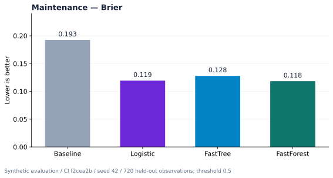
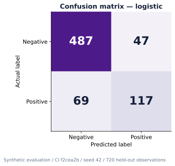
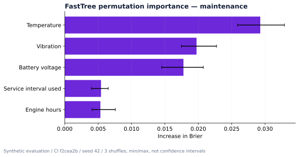
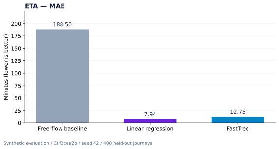
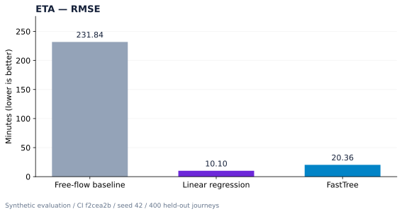

# Аналитика и результаты ML

[English](README.md) · [Engineering handbook](../engineering/README.ru.md) · [Project README](../../README.ru.md)

Синтетический эксперимент, seed 42; 720 наблюдений ТО, 400 поездок ETA. Реальная эффективность не подтверждена.

## Maintenance

| Model | F1 ↑ | Recall ↑ | Brier ↓ | TP | FP | FN | TN |
| --- | ---: | ---: | ---: | ---: | ---: | ---: | ---: |
| baseline | 0.000 | 0.000 | 0.193 | 0 | 0 | 186 | 534 |
| logistic | 0.669 | 0.629 | 0.119 | 117 | 47 | 69 | 487 |
| fastTree | 0.609 | 0.565 | 0.128 | 105 | 54 | 81 | 480 |
| fastForest | 0.649 | 0.591 | 0.118 | 110 | 43 | 76 | 491 |

Logistic имеет максимальные F1 и recall при пороге 0,5; FastForest — минимальный Brier. Автоматического выбора победителя нет.

### Maintenance F1

[PNG](analytics/maintenance-f1.png)

### Maintenance Brier

[PNG](analytics/maintenance-brier.png)

### Maintenance Recall

[PNG](analytics/maintenance-recall.png)

### Confusion Logistic

[PNG](analytics/confusion-logistic.png)

### Confusion Fasttree

[PNG](analytics/confusion-fasttree.png)

### Confusion Fastforest

[PNG](analytics/confusion-fastforest.png)

### Maintenance Permutation

[PNG](analytics/maintenance-permutation.png)

## ETA

| Model | MAE (min) ↓ | RMSE (min) ↓ | R² |
| --- | ---: | ---: | ---: |
| baseline | 188.50 | 231.84 | 0.3733 |
| linear | 7.94 | 10.10 | 0.9988 |
| fastTree | 12.75 | 20.36 | 0.9952 |

Линейная модель лучше FastTree по MAE/RMSE в этом запуске; перенос на реальные дороги не проверен.

### Eta Mae

[PNG](analytics/eta-mae.png)

### Eta Rmse

[PNG](analytics/eta-rmse.png)

### Eta Permutation

[PNG](analytics/eta-permutation.png)

Permutation importance: разброс трёх перестановок, не доверительные интервалы и не причинность. ROC/PR/calibration не построены: нет индивидуальных прогнозов. [Манифест](analytics/source-manifest.json).
