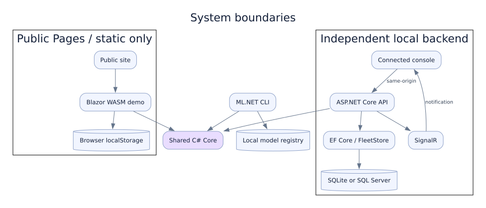
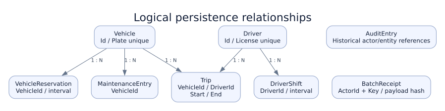
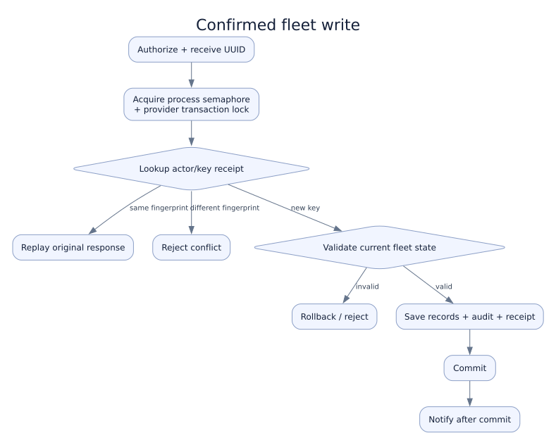
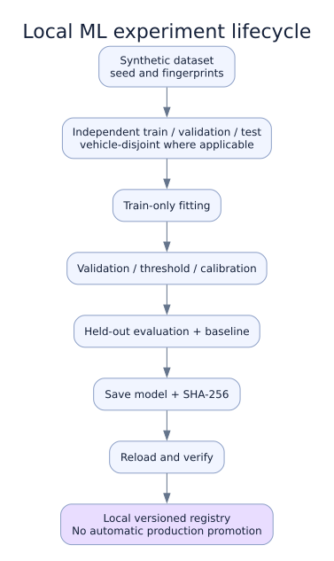
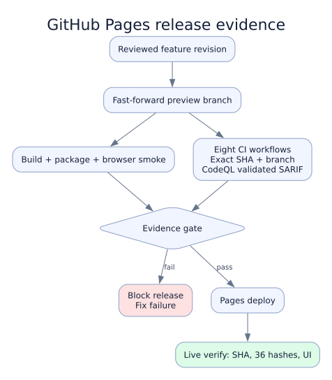
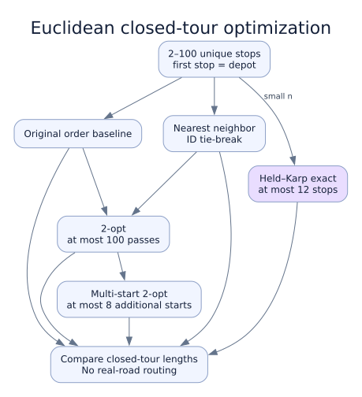
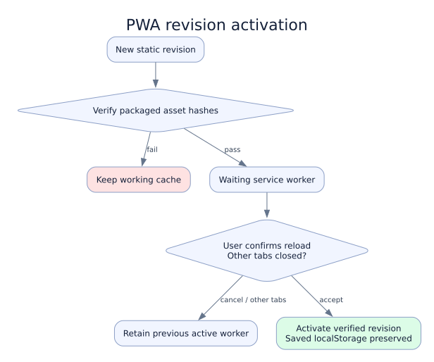

# Engineering diagrams

[Русский](README.ru.md) · [Engineering handbook](../engineering/README.md) · [Project README](../../README.md)

Editable Graphviz DOT sources.

## System boundaries

Public demo is independent of the connected API and ML trainer.

[PNG](diagrams/architecture.png) · [DOT](diagrams/architecture.dot)

## Logical persistence relationships

Logical relationships, not a physical migration.

[PNG](diagrams/data-model.png) · [DOT](diagrams/data-model.dot)

## Confirmed fleet write

Replay, validation and commit paths under the lock.

[PNG](diagrams/write-transaction.png) · [DOT](diagrams/write-transaction.dot)

## Local ML experiment lifecycle

Synthetic training and evaluation, no production deployment.

[PNG](diagrams/ml-pipeline.png) · [DOT](diagrams/ml-pipeline.dot)

## GitHub Pages release evidence

Exact branch/SHA evidence before Pages publication.

[PNG](diagrams/release-pipeline.png) · [DOT](diagrams/release-pipeline.dot)

## Euclidean closed-tour optimization

Euclidean tours, not road-network routing.

[PNG](diagrams/route-algorithms.png) · [DOT](diagrams/route-algorithms.dot)

## PWA revision activation

Integrity-verified worker activation.

[PNG](diagrams/pwa-update.png) · [DOT](diagrams/pwa-update.dot)
