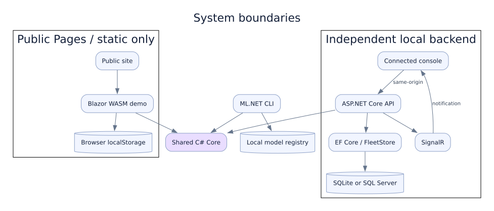
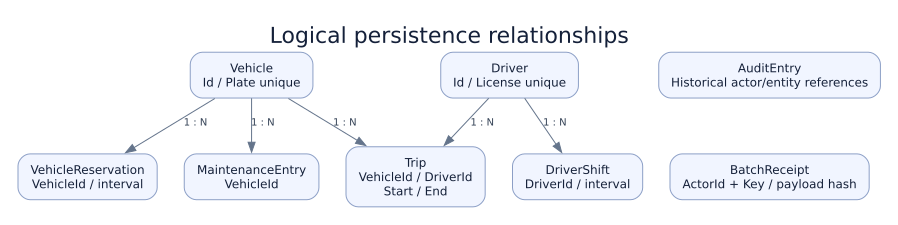
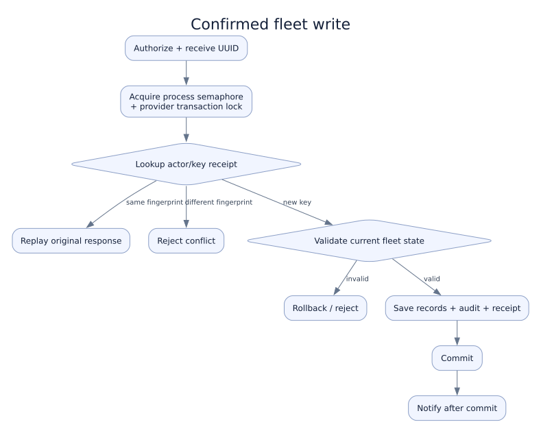
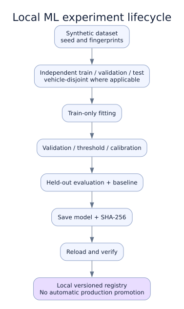
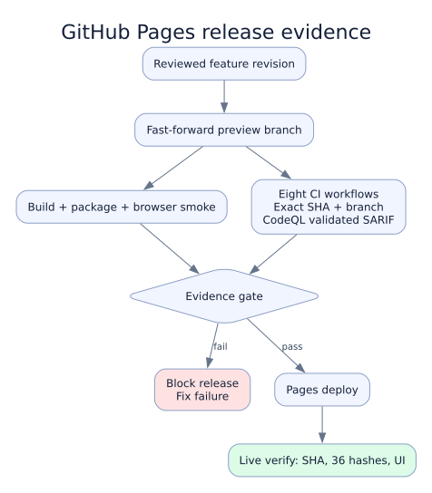
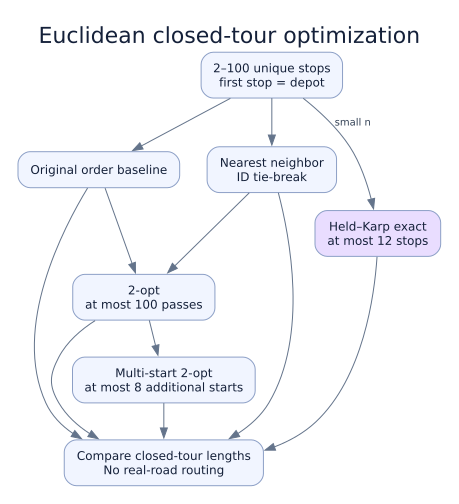
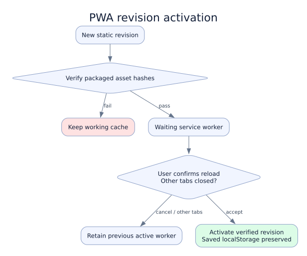

# Инженерные диаграммы

**Русский** · [English](diagrams.md)

[README проекта](../../README.ru.md) · [Визуальный раздел](README.ru.md) · [Галерея](gallery.ru.md) · [Диаграммы](diagrams.ru.md) · [ML](analytics.ru.md) · [Инженерное руководство](../engineering/README.ru.md)

Редактируемые исходники Graphviz; подписи на английском.

**На этой странице**

- [Границы системы](#границы-системы)
- [Логические связи данных](#логические-связи-данных)
- [Подтверждённая операция записи](#подтверждённая-операция-записи)
- [Жизненный цикл локального ML-эксперимента](#жизненный-цикл-локального-ml-эксперимента)
- [Проверки релиза GitHub Pages](#проверки-релиза-github-pages)
- [Оптимизация замкнутого маршрута](#оптимизация-замкнутого-маршрута)
- [Активация версии PWA](#активация-версии-pwa)

## Границы системы

Демо независимо от подключённого API и ML Trainer.

[PNG](diagrams/architecture.png) · [DOT](diagrams/architecture.dot)

## Логические связи данных

Логические связи, не физическая миграция.

[PNG](diagrams/data-model.png) · [DOT](diagrams/data-model.dot)

## Подтверждённая операция записи

Повтор, проверка и commit под блокировкой.

[PNG](diagrams/write-transaction.png) · [DOT](diagrams/write-transaction.dot)

## Жизненный цикл локального ML-эксперимента

Синтетическое обучение без промышленного развёртывания.

[PNG](diagrams/ml-pipeline.png) · [DOT](diagrams/ml-pipeline.dot)

## Проверки релиза GitHub Pages

Подтверждение точной ветки/SHA перед Pages.

[PNG](diagrams/release-pipeline.png) · [DOT](diagrams/release-pipeline.dot)

## Оптимизация замкнутого маршрута

Евклидовы туры, не дорожная сеть.

[PNG](diagrams/route-algorithms.png) · [DOT](diagrams/route-algorithms.dot)

## Активация версии PWA

Активация worker после проверки хешей.

[PNG](diagrams/pwa-update.png) · [DOT](diagrams/pwa-update.dot)

---

[README проекта](../../README.ru.md) · [Визуальный раздел](README.ru.md) · [English](diagrams.md)
