# Actual application screenshots

**English** · [Русский](gallery.ru.md)

[Project README](../../README.md) · [Visual index](README.md) · [Gallery](gallery.md) · [Diagrams](diagrams.md) · [ML](analytics.md) · [Engineering handbook](../engineering/README.md)

23 individual CI screenshots. Expand a capture, then select it to view the full byte-exact PNG. Synthetic data.

**On this page**

- [Operations](#operations)
- [Simulation and optimization](#simulation-and-optimization)
- [Analytics and experiments](#analytics-and-experiments)
- [Mobile](#mobile)

## Operations

### Overview — dark theme

[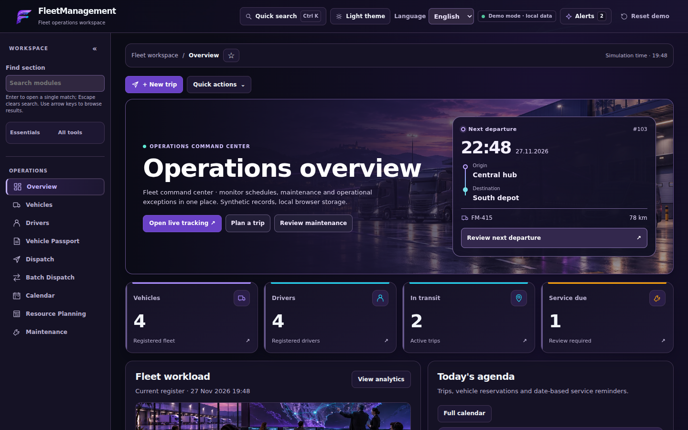](screenshots/dashboard-dark.png)

Original: 1440 × 3784 px · v63-overview-dark.png.

### Overview — light theme

Expand individual capture

Original: 1440 × 3784 px · v63-overview-light.png.

### Russian workspace

Expand individual capture

Original: 320 × 7074 px · v63-overview-ru.png.

### Vehicle register

Expand individual capture

Original: 1440 × 1364 px · v63-vehicle-cards.png.

### Vehicle passport

Expand individual capture

[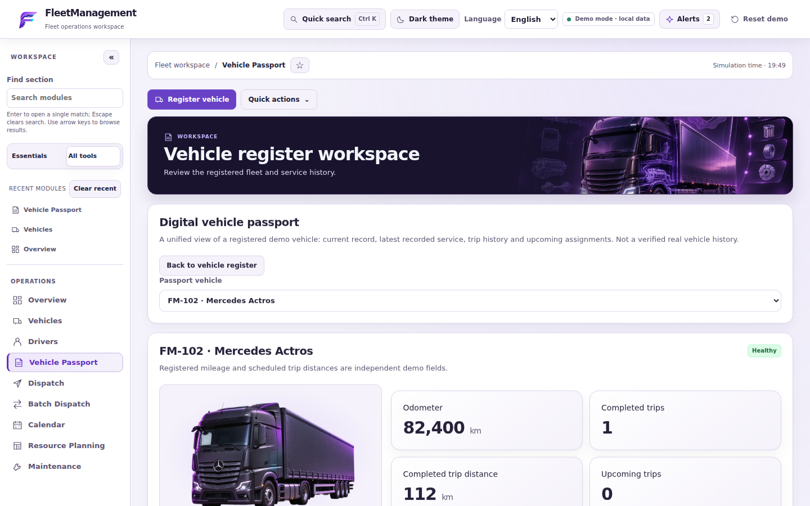](screenshots/vehicle-passport.png)

Original: 1440 × 1978 px · vehicle-passport.png.

### Driver register

Expand individual capture

[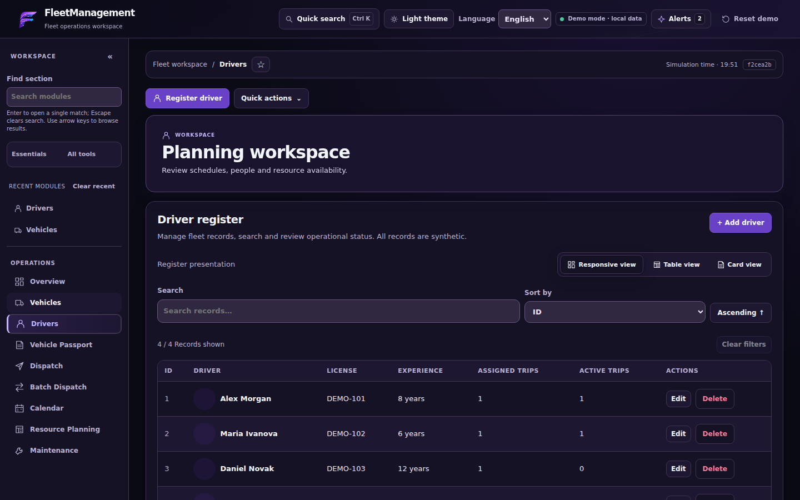](screenshots/drivers.png)

Original: 1440 × 900 px · v4-modules/drivers-desktop.png.

### Operations calendar

Expand individual capture

Original: 1440 × 1464 px · calendar.png.

### Dispatch

Expand individual capture

[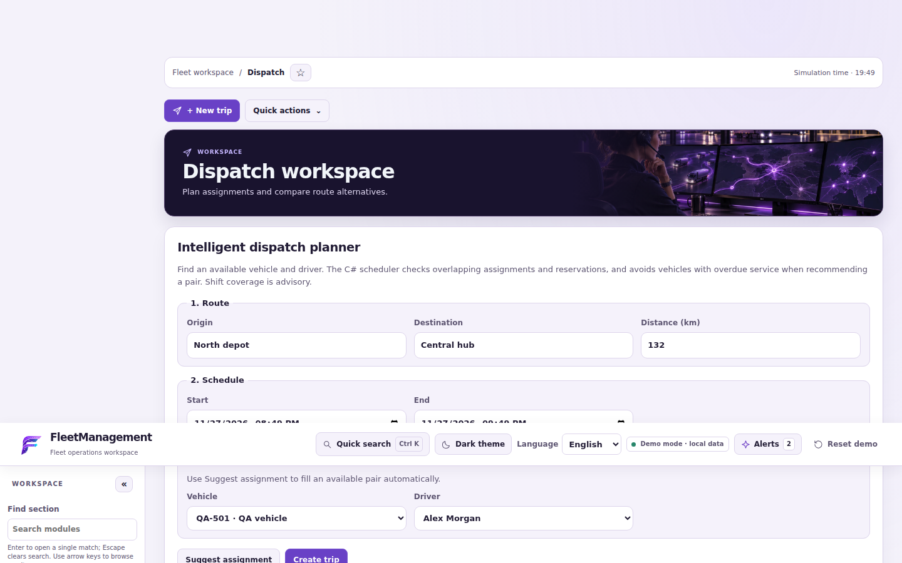](screenshots/dispatch.png)

Original: 1440 × 1702 px · dispatch.png.

### Batch dispatch

Expand individual capture

Original: 1440 × 1690 px · batch-dispatch.png.

### Maintenance workflow

Expand individual capture

[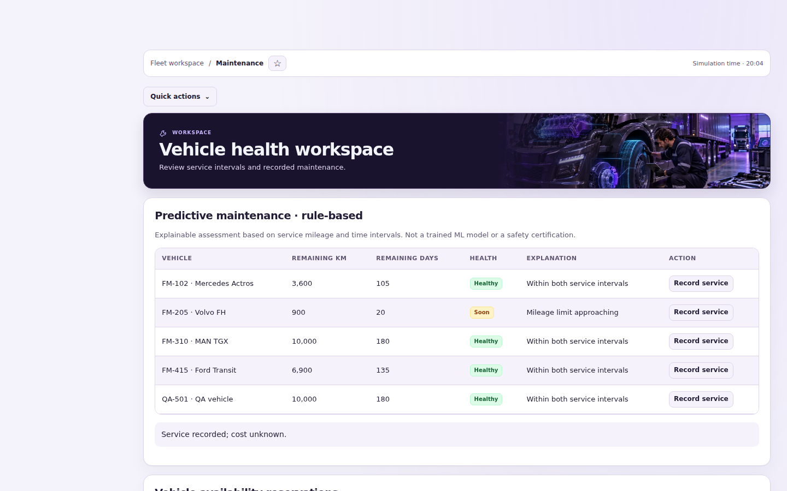](screenshots/maintenance.png)

Original: 1440 × 2403 px · maintenance.png.

## Simulation and optimization

### Route optimization

Expand individual capture

[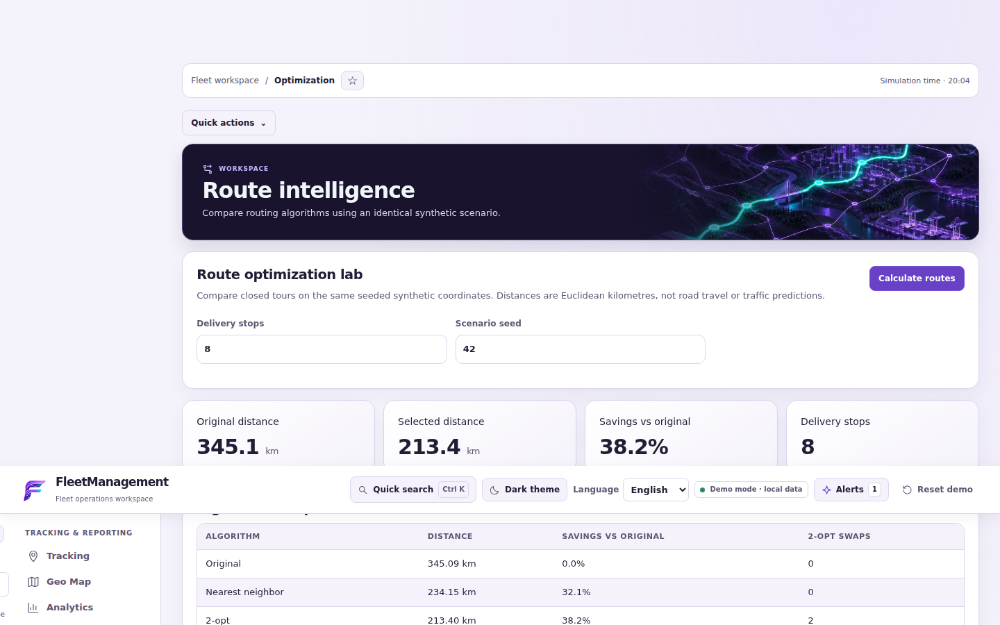](screenshots/route-optimization.png)

Original: 1440 × 1807 px · optimization.png.

### Digital twin simulation

Expand individual capture

Original: 1440 × 3318 px · digital-twin.png.

### Simulated geographic map

Expand individual capture

Original: 1440 × 1729 px · geographic-map.png.

## Analytics and experiments

### Analytics and reporting

Expand individual capture

Original: 1440 × 4362 px · analytics.png.

### Cost intelligence

Expand individual capture

[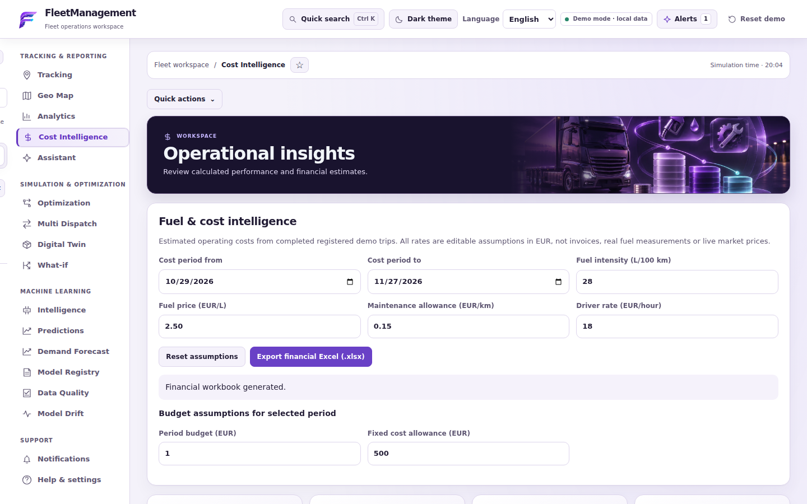](screenshots/cost-intelligence.png)

Original: 1440 × 3316 px · cost-intelligence.png.

### Machine learning lab

Expand individual capture

[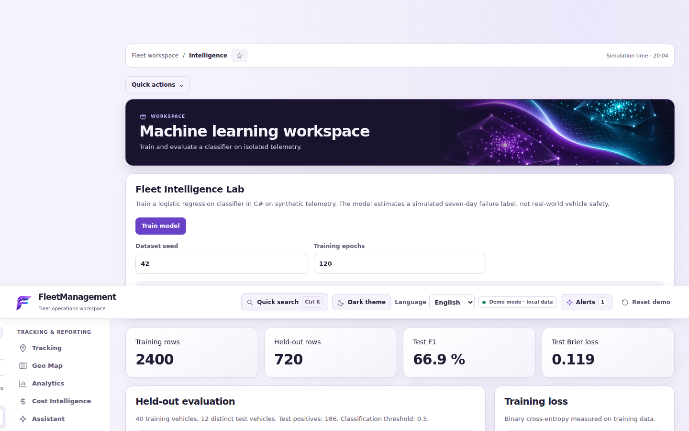](screenshots/machine-learning.png)

Original: 1440 × 2703 px · intelligence.png.

### Maintenance ensemble

Expand individual capture

[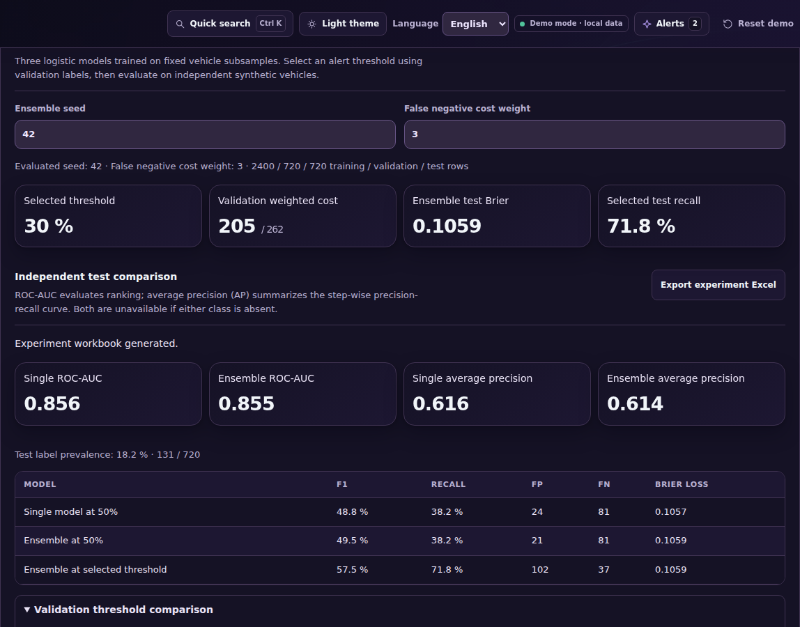](screenshots/maintenance-ensemble.png)

Original: 1148 × 2742 px · v5-ensemble.png.

### Demand forecast

Expand individual capture

Original: 1440 × 2426 px · demand-forecast.png.

### Model drift

Expand individual capture

Original: 1440 × 2070 px · model-drift.png.

### Local model registry

Expand individual capture

[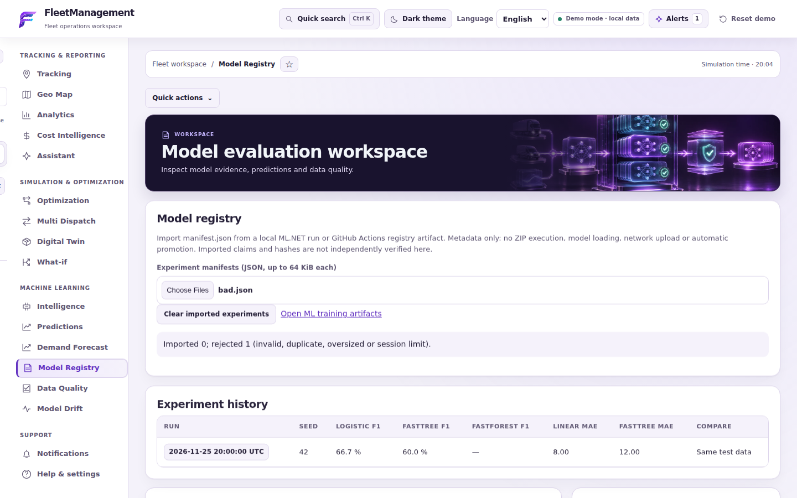](screenshots/model-registry.png)

Original: 1440 × 1657 px · model-registry.png.

### Rule-based assistant

Expand individual capture

[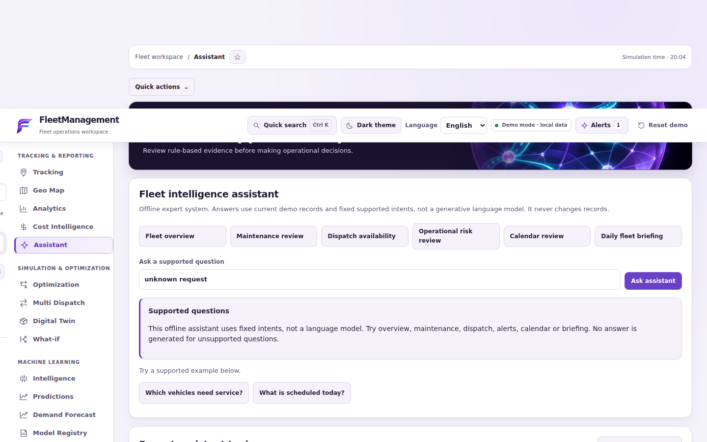](screenshots/assistant.png)

Original: 1440 × 1445 px · assistant.png.

### Prediction experiments

Expand individual capture

[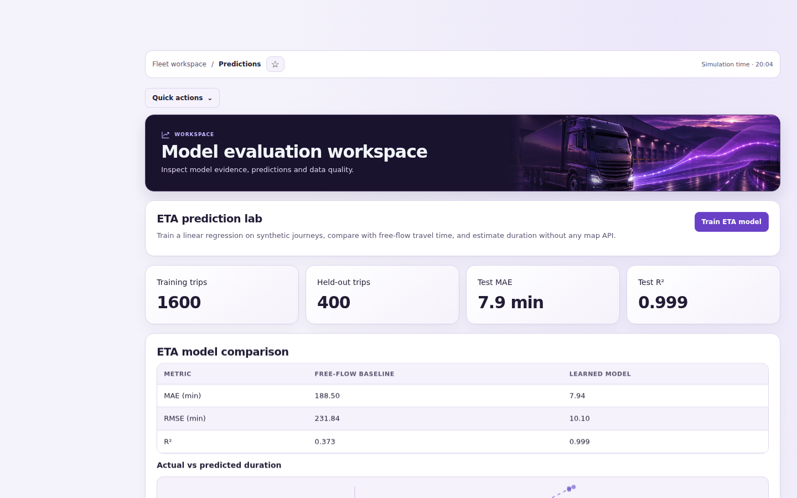](screenshots/predictions.png)

Original: 1440 × 3388 px · predictions.png.

## Mobile

### Mobile overview

Expand individual capture

Original: 320 × 6687 px · v63-overview-mobile.png.

---

[Project README](../../README.md) · [Visual index](README.md) · [Русский](gallery.ru.md)
