# Actual application screenshots

[Русский](README.ru.md) · [Engineering handbook](../engineering/README.md) · [Project README](../../README.md)

Click each individual viewport image for its full byte-exact PNG. Synthetic data.

## Operations

### Overview — dark theme

Original: 1440 × 3784 px · v63-overview-dark.png.

### Overview — light theme

[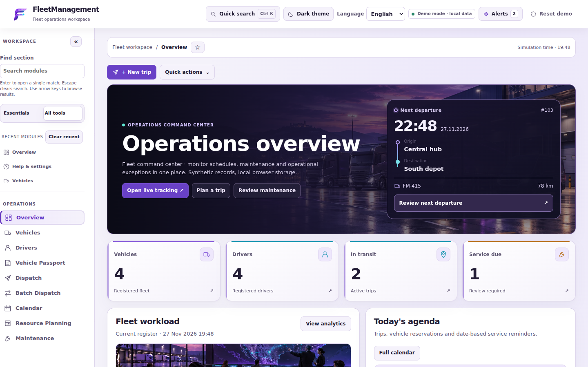](screenshots/dashboard-light.png)

Original: 1440 × 3784 px · v63-overview-light.png.

### Russian workspace

[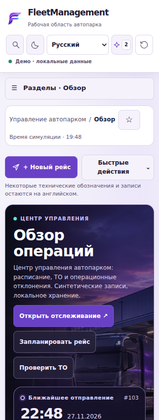](screenshots/dashboard-ru.png)

Original: 320 × 7074 px · v63-overview-ru.png.

### Vehicle register

[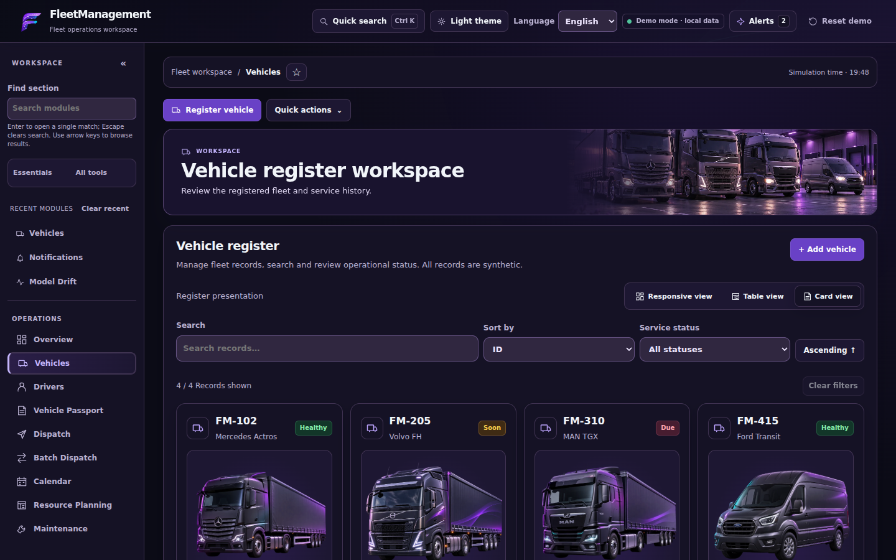](screenshots/vehicles-cards.png)

Original: 1440 × 1364 px · v63-vehicle-cards.png.

### Vehicle passport

Original: 1440 × 1978 px · vehicle-passport.png.

### Driver register

Original: 1440 × 900 px · v4-modules/drivers-desktop.png.

### Operations calendar

[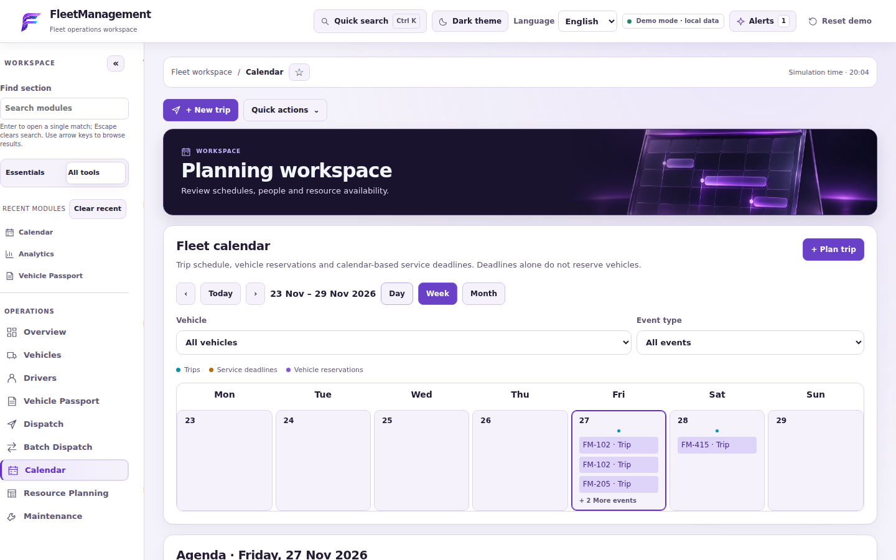](screenshots/calendar.png)

Original: 1440 × 1464 px · calendar.png.

### Dispatch

Original: 1440 × 1702 px · dispatch.png.

### Batch dispatch

[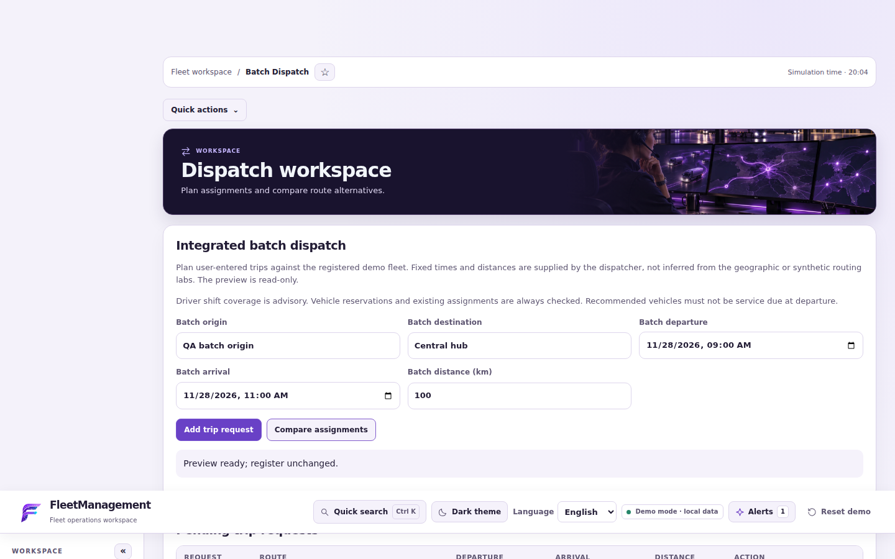](screenshots/batch-dispatch.png)

Original: 1440 × 1690 px · batch-dispatch.png.

### Maintenance workflow

Original: 1440 × 2403 px · maintenance.png.

## Simulation and optimization

### Route optimization

Original: 1440 × 1807 px · optimization.png.

### Digital twin simulation

[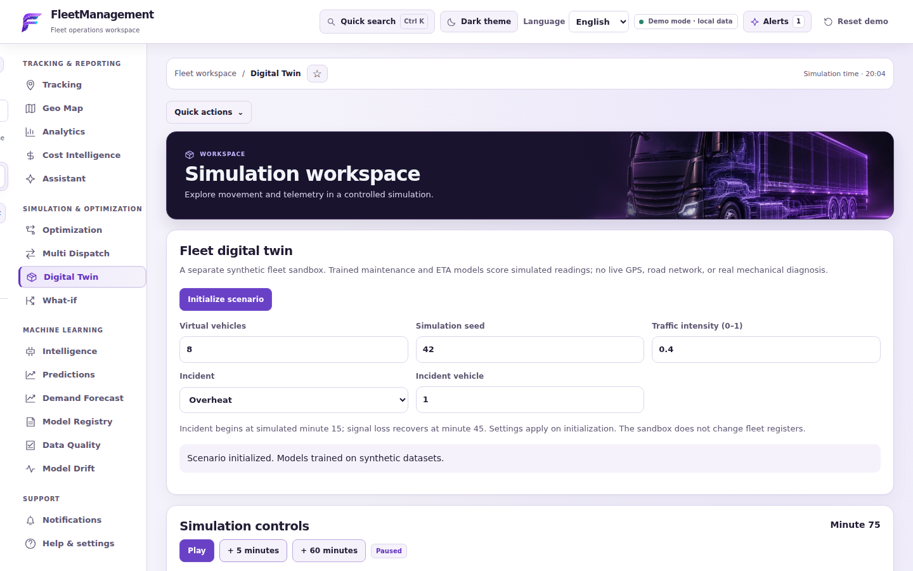](screenshots/digital-twin.png)

Original: 1440 × 3318 px · digital-twin.png.

### Simulated geographic map

[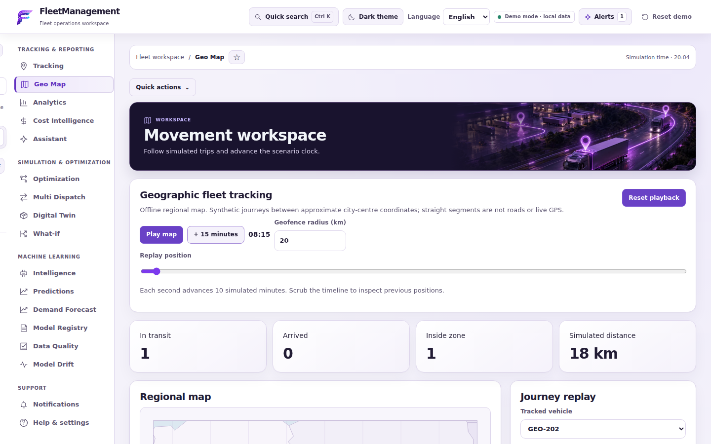](screenshots/geographic-map.png)

Original: 1440 × 1729 px · geographic-map.png.

## Analytics and experiments

### Analytics and reporting

[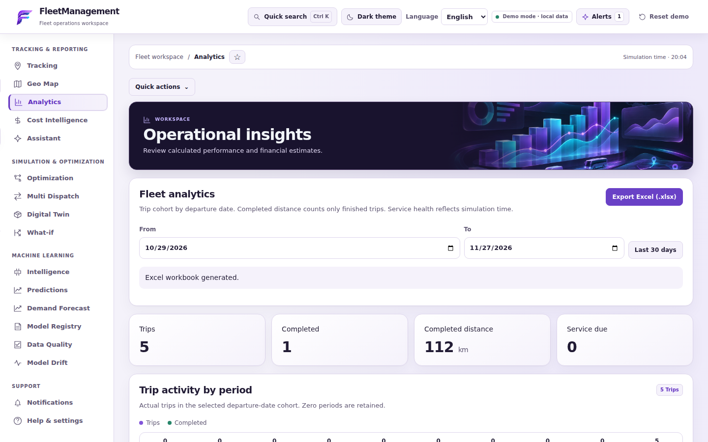](screenshots/analytics.png)

Original: 1440 × 4362 px · analytics.png.

### Cost intelligence

Original: 1440 × 3316 px · cost-intelligence.png.

### Machine learning lab

Original: 1440 × 2703 px · intelligence.png.

### Maintenance ensemble

Original: 1148 × 2742 px · v5-ensemble.png.

### Demand forecast

[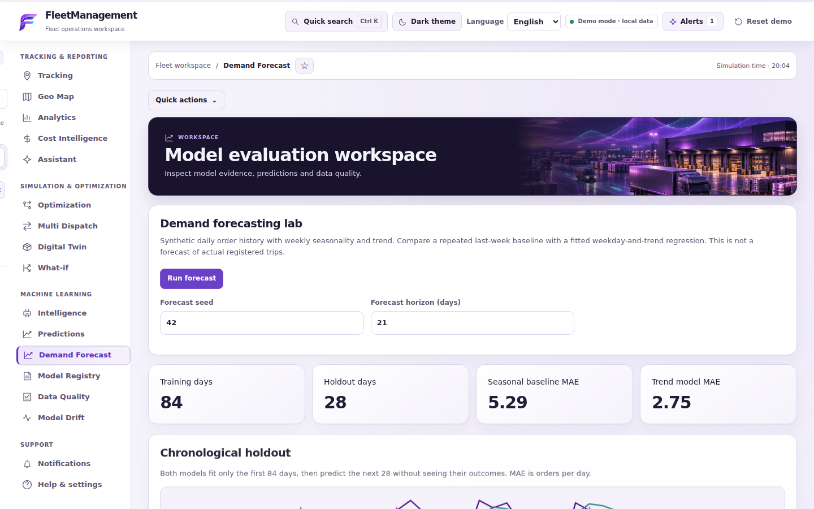](screenshots/demand-forecast.png)

Original: 1440 × 2426 px · demand-forecast.png.

### Model drift

[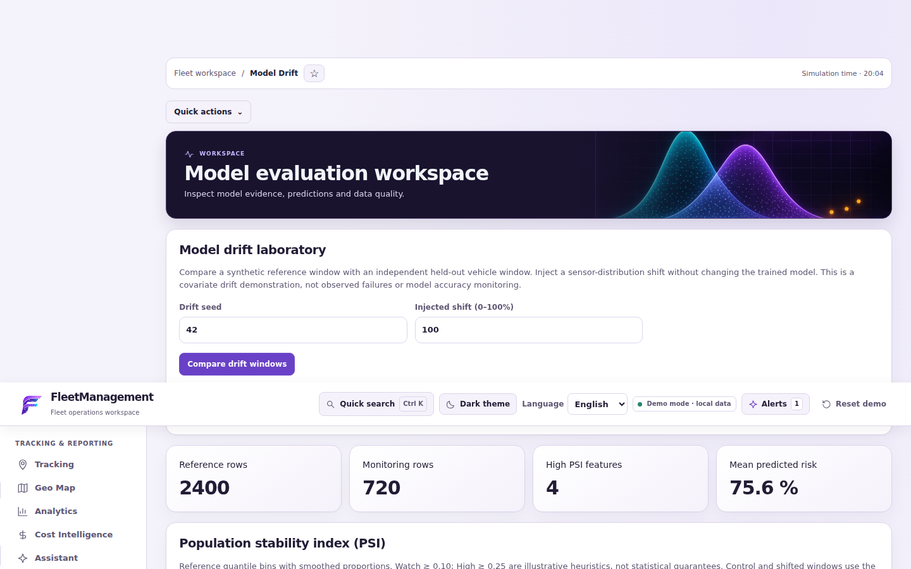](screenshots/model-drift.png)

Original: 1440 × 2070 px · model-drift.png.

### Local model registry

Original: 1440 × 1657 px · model-registry.png.

### Rule-based assistant

Original: 1440 × 1445 px · assistant.png.

### Prediction experiments

Original: 1440 × 3388 px · predictions.png.

## Mobile

### Mobile overview

[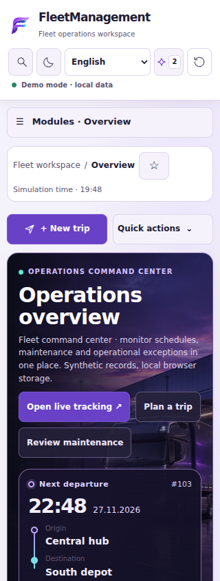](screenshots/mobile-dashboard.png)

Original: 320 × 6687 px · v63-overview-mobile.png.
