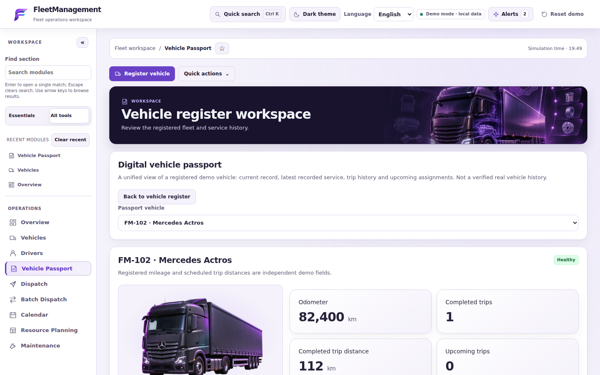
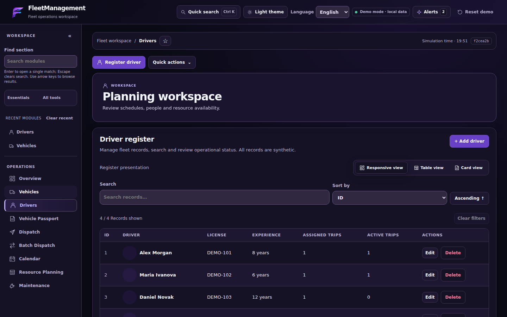
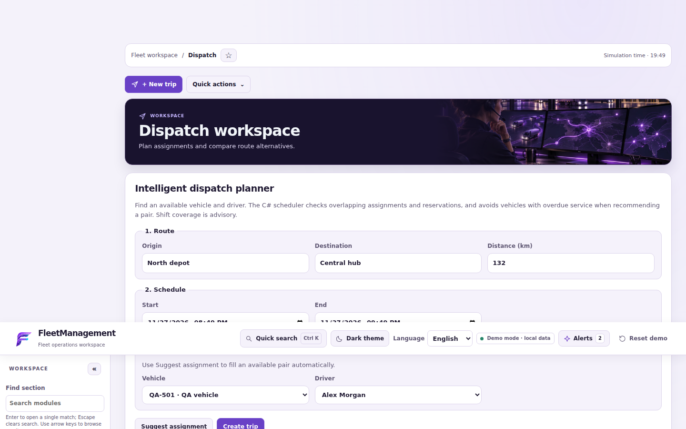

# Галерея реальных скриншотов

**Русский** · [English](gallery.md)

[README проекта](../../README.ru.md) · [Визуальный раздел](README.ru.md) · [Галерея](gallery.ru.md) · [Диаграммы](diagrams.ru.md) · [ML](analytics.ru.md) · [Инженерное руководство](../engineering/README.ru.md)

23 отдельных скриншота CI. Раскройте нужный кадр и нажмите на него для просмотра полного оригинального PNG. Синтетические данные.

**На этой странице**

- [Операции](#операции)
- [Симуляция и оптимизация](#симуляция-и-оптимизация)
- [Аналитика и эксперименты](#аналитика-и-эксперименты)
- [Мобильная версия](#мобильная-версия)

## Операции

### Обзор — тёмная тема

Оригинал: 1440 × 3784 px · v63-overview-dark.png.

### Обзор — светлая тема

Открыть отдельный кадр

Оригинал: 1440 × 3784 px · v63-overview-light.png.

### Русский интерфейс

Открыть отдельный кадр

Оригинал: 320 × 7074 px · v63-overview-ru.png.

### Реестр транспорта

Открыть отдельный кадр

Оригинал: 1440 × 1364 px · v63-vehicle-cards.png.

### Паспорт автомобиля

Открыть отдельный кадр

Оригинал: 1440 × 1978 px · vehicle-passport.png.

### Реестр водителей

Открыть отдельный кадр

Оригинал: 1440 × 900 px · v4-modules/drivers-desktop.png.

### Операционный календарь

Открыть отдельный кадр

Оригинал: 1440 × 1464 px · calendar.png.

### Диспетчеризация

Открыть отдельный кадр

Оригинал: 1440 × 1702 px · dispatch.png.

### Пакетная диспетчеризация

Открыть отдельный кадр

Оригинал: 1440 × 1690 px · batch-dispatch.png.

### Техническое обслуживание

Открыть отдельный кадр

Оригинал: 1440 × 2403 px · maintenance.png.

## Симуляция и оптимизация

### Оптимизация маршрута

Открыть отдельный кадр

Оригинал: 1440 × 1807 px · optimization.png.

### Симуляция цифрового двойника

Открыть отдельный кадр

Оригинал: 1440 × 3318 px · digital-twin.png.

### Симуляционная карта

Открыть отдельный кадр

Оригинал: 1440 × 1729 px · geographic-map.png.

## Аналитика и эксперименты

### Аналитика и отчётность

Открыть отдельный кадр

Оригинал: 1440 × 4362 px · analytics.png.

### Аналитика затрат

Открыть отдельный кадр

Оригинал: 1440 × 3316 px · cost-intelligence.png.

### Лаборатория ML

Открыть отдельный кадр

Оригинал: 1440 × 2703 px · intelligence.png.

### Ансамбль моделей ТО

Открыть отдельный кадр

Оригинал: 1148 × 2742 px · v5-ensemble.png.

### Прогноз спроса

Открыть отдельный кадр

Оригинал: 1440 × 2426 px · demand-forecast.png.

### Дрейф модели

Открыть отдельный кадр

Оригинал: 1440 × 2070 px · model-drift.png.

### Локальный реестр моделей

Открыть отдельный кадр

Оригинал: 1440 × 1657 px · model-registry.png.

### Детерминированный помощник

Открыть отдельный кадр

Оригинал: 1440 × 1445 px · assistant.png.

### Эксперименты прогнозирования

Открыть отдельный кадр

Оригинал: 1440 × 3388 px · predictions.png.

## Мобильная версия

### Мобильный обзор

Открыть отдельный кадр

Оригинал: 320 × 6687 px · v63-overview-mobile.png.

---

[README проекта](../../README.ru.md) · [Визуальный раздел](README.ru.md) · [English](gallery.md)
